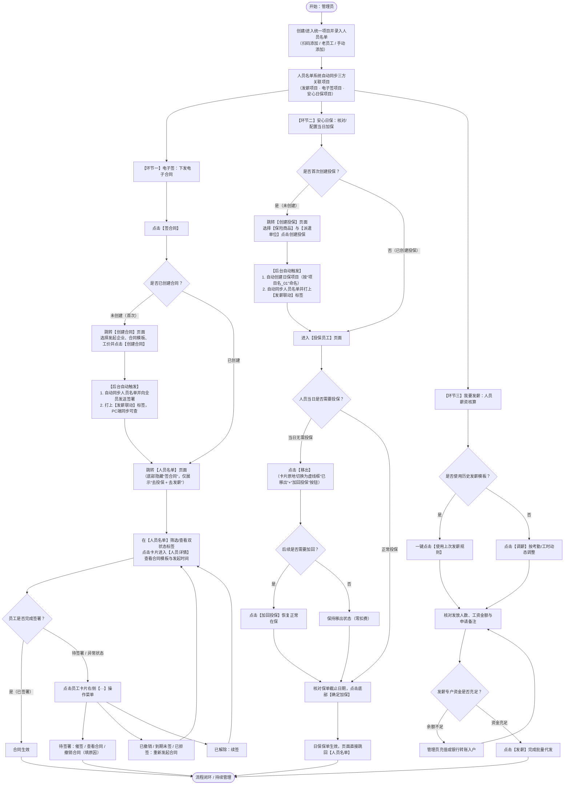

# 发薪管理系统（电子合同 · 安心日保 · 我要发薪）全链路产品需求文档（PRD）

---

## 1. 文档信息与修订记录

### 1.1 文档基本信息

| 属性 | 内容 |
| :--- | :--- |
| **产品名称** | 发薪全链路管理系统（电子合同 · 安心日保 · 我要发薪一体化联动） |
| **产品形态** | 微信小程序 / H5 移动端 + 安心日保 PC 管理后台 |
| **在线原型地址** | [http://faxin_xcx.tangyun.abrdns.com/index.html#page=shouye](http://faxin_xcx.tangyun.abrdns.com/index.html#page=shouye) |
| **本地原型工作台** | [index.html](file:///d:/Desktop/发薪竞品分析/index.html) |
| **全局业务流程图** | [flowchart.html](file:///d:/Desktop/发薪竞品分析/flowchart.html) / [发薪全链路业务流程图.drawio](file:///d:/Desktop/发薪竞品分析/发薪全链路业务流程图（1比1图二效果可直接编辑）.drawio) |
| **当前版本** | V2.0（人员名单中枢收口版） |
| **文档状态** | 已定稿（待研发排期评审） |
| **撰写日期** | 2026-11-05 |

### 1.2 版本修订历史

| 版本号 | 修订日期 | 修订人 | 修订说明 |
| :--- | :--- | :--- | :--- |
| **V1.0** | 2026-10-19 | 产品经理 | 初版全链路方案：打通发薪项目、电子合同与安心日保三大模块，实现人员名单同源同步。 |
| **V1.5** | 2026-11-04 | 产品经理 | 精简安心日保人员操作（移除批量冗余按钮，改为单卡「移出/加回投保」原地切换），新增 PC 端联动标识与重复加保防呆机制。 |
| **V2.0** | 2026-11-05 | 产品经理 | **核心架构收口升级**： 1. 取消独立的「合同详情页」，将合同签署状态展示、组合筛选及干预操作（催签/查看/撤销/重签/续签）全量收口至 **[人员名单](file:///d:/Desktop/发薪竞品分析/project_detail.html)**； 2. **[创建合同](file:///d:/Desktop/发薪竞品分析/contract_create.html)** 新增 `*合同模版` 必填项，点击「创建合同」自动向全员发送签署并直接跳回 **[人员名单](file:///d:/Desktop/发薪竞品分析/project_detail.html)**（底部操作栏自动收敛为「去投保 + 去发薪」双按钮）； 3. **[投保员工](file:///d:/Desktop/发薪竞品分析/insurance_add.html)** 补齐底部固定主按钮「确定加保」，点击后保单生效并直接返回 **[人员名单](file:///d:/Desktop/发薪竞品分析/project_detail.html)**； 4. **[人员详情](file:///d:/Desktop/发薪竞品分析/employee_detail.html)** 新增「合同模板」、「合同发起时间」及平铺式「保险详情」档案。 |

---

## 2. 名词解释与核心业务概念

| 专有名词 | 业务定义与规则说明 |
| :--- | :--- |
| **发薪项目（统一项目）** | 管理员在发薪端创建的业务容器（如“发薪”、“环境治理”）。每个发薪项目拥有唯一的人员名单池，作为电子签、安心日保、薪资核算的**唯一同源名单底座**。 |
| **名单同源与自动同步** | 管理员通过扫码、老员工导入或手动身份证识别将人员录入发薪项目后，一旦触发「签合同」或「去投保」，系统后台自动将该名单同步至电子签项目及安心日保项目，无需二次导入。 |
| **平行解耦架构** | 「电子合同」、「安心日保」、「我要发薪」三大业务在流程上相互独立、非强制串行阻塞。无论企业是否开通电子签/日保、员工是否完成签署或投保，均**不影响**「我要发薪」的正常核算与发放。 |
| **发薪联动标签** | 由发薪项目首次触发生成的电子签项目或安心日保项目，系统自动打上 `发薪联动` 标签，并按 `统一项目名称_01` 规则自动命名（安心日保端）。在 **[安心日保PC端](file:///d:/Desktop/发薪竞品分析/pc_insure_daily_ax.html)** 中，带有该标签的项目禁止独立重复加保，统一由发薪端管控名单。 |
| **原地移出 / 加回投保** | 在 **[投保员工](file:///d:/Desktop/发薪竞品分析/insurance_add.html)** 页面中，针对当日无需上岗投保的人员，管理员点击「移出」后卡片不发生物理删除，而是原地变为虚线框 `已移出` 状态（当日零扣费），右侧按钮变为「加回投保」，支持随时一键恢复在保。 |
| **双状态徽章** | 在 **[人员名单](file:///d:/Desktop/发薪竞品分析/project_detail.html)** 的每张员工卡片左上方，并列展示该员工的**合同签署状态**（待签署/已签署/已撤销/到期未签/已拒签/已解除）与**日保状态**（保障中/未投保）。 |

---

## 3. 产品概述

### 3.1 业务背景与核心痛点
在灵活用工、制造业蓝领派遣、日结/短期用工场景中，企业驻场管理员（驻厂老师、项目主管、劳务经理）每天高频处理三件事：**入职签合同、上岗买日保、完工发薪水**。
原有业务模式下存在三大痛点：
1. **多系统割裂、重复建项与导表**：电子合同、安心日保、发薪专户分属不同产品模块，管理员需建三个项目、导入三次名单，极易出现名单不一致、漏签漏保。
2. **页面层级过深、状态分散**：查看谁签了合同要去合同列表，查看谁买了保险要去保单列表，核对发薪又要回发薪列表，缺乏统一的「人员全链路视图」。
3. **日保名单动态调整繁琐**：日结工流动性大，每天实际到岗人数变化频繁，传统删人重加模式操作成本高且容易误删档案。

### 3.2 产品目标
1. **一站式闭环体验**：让企业在一个发薪项目里一站式完成「签合同、去投保、去发薪」，消除跨产品切换成本。
2. **以「人员名单」为唯一管理中枢**：将合同签署状态、在保状态、组合筛选及单人合同干预操作全部收口至 **[人员名单](file:///d:/Desktop/发薪竞品分析/project_detail.html)** 与 **[人员详情](file:///d:/Desktop/发薪竞品分析/employee_detail.html)**，实现“一张名单管全链路”。
3. **首次配置即创建，二次进入直达业务**：
   - **电子合同**：首次点击进入 **[创建合同](file:///d:/Desktop/发薪竞品分析/contract_create.html)** 选定企业与模板并自动全员发签；已创建后再次点击「签合同」直接进入 **[人员名单](file:///d:/Desktop/发薪竞品分析/project_detail.html)** 查看和管理签署进度，且底部栏自动隐藏「签合同」按钮（仅展示「去投保 + 去发薪」）。
   - **安心日保**：首次点击进入 **[创建投保](file:///d:/Desktop/发薪竞品分析/insurance_create.html)** 绑定保险商品与派遣单位；已创建后再次点击「去投保」直接进入 **[投保员工](file:///d:/Desktop/发薪竞品分析/insurance_add.html)** 进行当日人员移出/加回与「确定加保」。

### 3.3 目标用户画像

| 角色名称 | 核心职责 | 高频使用场景 | 核心诉求 |
| :--- | :--- | :--- | :--- |
| **驻场管理员 / 劳务领队** | 现场招工录入、组织签合同、每日晨会核对上岗加保名单、考勤报工 | 移动端（小程序）现场扫码招人、一键发合同、当日未到岗人员移出投保 | 操作极简、不跳出当前项目、一眼看清谁没签合同/谁没买保险 |
| **企业人事 / 运营主管** | 合同模板维护、派遣单位管理、异常合同处理（催签/撤销/重签）、保单台账核查 | 移动端 + **[安心日保PC端](file:///d:/Desktop/发薪竞品分析/pc_insure_daily_ax.html)** 协同 | 状态清晰可筛选、历史合同与加保记录有据可查、防止多端重复投保 |
| **企业财务 / 老板** | 发薪规则审核、发薪专户充值、批量代发工资与回单归档 | 移动端 **[我要发薪](file:///d:/Desktop/发薪竞品分析/pay_salary.html)** 核算与发放 | 发薪不被前置流程卡死、支持复用上次发薪规则、资金安全准确 |

---

## 4. 全局业务流程与状态机设计

### 4.1 全链路业务流程图（Mermaid）
> 完整可视化大图请查看：[flowchart.html](file:///d:/Desktop/发薪竞品分析/flowchart.html)

### 4.2 核心业务状态机

#### （1）项目级「合同与投保」开通及创建状态机
| 项目维度状态 | 判定条件 | 首页按钮表现 | 人员名单底部栏表现 | 点击跳转目标 |
| :--- | :--- | :--- | :--- | :--- |
| **未开通权限** | 企业未签约开通电子合同或安心日保服务 | 对应按钮置灰不可点击（`disabled`），点击弱提示“企业暂未开通该服务” | 对应按钮置灰不可点击 | 不跳转 |
| **已开通 · 未创建合同** | `hasCreatedContract = false` | 「签合同」正常高亮可点 | 显示 3 个按钮：`签合同` + `去投保` + `去发薪` | 跳转 **[创建合同](file:///d:/Desktop/发薪竞品分析/contract_create.html)** |
| **已开通 · 已创建合同** | `hasCreatedContract = true` | 「签合同」正常可点（文案不变） | **隐藏 `签合同` 按钮**，仅显示 2 个按钮：`去投保` + `去发薪` | 直接跳转 **[人员名单](file:///d:/Desktop/发薪竞品分析/project_detail.html)** |
| **已开通 · 未创建投保** | `hasCreatedInsurance = false` | 「去投保」正常高亮可点 | 「去投保」正常可点 | 跳转 **[创建投保](file:///d:/Desktop/发薪竞品分析/insurance_create.html)** |
| **已开通 · 已创建投保** | `hasCreatedInsurance = true` | 「去投保」正常可点（文案不变） | 「去投保」正常可点 | 直接跳转 **[投保员工](file:///d:/Desktop/发薪竞品分析/insurance_add.html)** |

#### （2）员工级「电子合同签署状态机」
| 状态名称 | 徽章视觉样式 | 触发条件 | 右侧 `···` 菜单可执行操作 | 操作后流转状态 |
| :--- | :--- | :--- | :--- | :--- |
| **待签署** | 橙色标签 (`#fff7ed`底 / `#ea580c`字) | 项目创建合同后自动下发，或管理员点击「重新发起合同」 | 1. **催签**（发送短信/小程序服务通知） 2. **查看合同**（预览合同PDF） 3. **撤销合同**（必填撤销原因弹窗） | 催签 $\rightarrow$ 保持`待签署` 撤销确认 $\rightarrow$ 流转为`已撤销` |
| **已签署** | 绿色标签 (`#f0fdf4`底 / `#16a34a`字) | 员工完成实名意愿认证并落章，企业自动落章生效 | 查看合同 | 终态（若发生离职解约可流转为`已解除`） |
| **已撤销** | 灰色标签 (`#f1f5f9`底 / `#64748b`字) | 管理员在员工签署前主动撤销合同 | **重新发起合同** | 点击后重新下发签署，流转为`待签署` |
| **到期未签** | 灰色标签 (`#f1f5f9`底 / `#64748b`字) | 超过合同签署截止有效期仍未完成签署 | 1. **重新发起合同** 2. **取消签署** | 重新发起 $\rightarrow$ `待签署` 取消签署 $\rightarrow$ 隐藏操作或归档 |
| **已拒签** | 红色/灰色警示标签 | 员工在签署端主动点击拒签 | 1. **重新发起合同** 2. **取消签署** | 重新发起 $\rightarrow$ `待签署` |
| **已解除** | 灰色标签 | 合同到期终止或双方协商解除劳动/劳务关系 | **续签** | 点击后按当前项目模板发起新周期合同，流转为`待签署` |

#### （3）员工级「安心日保状态机」
| 状态名称 | 所在页面与视觉表现 | 业务规则说明 | 可执行操作与流转 |
| :--- | :--- | :--- | :--- |
| **保障中（在保）** | **[人员名单](file:///d:/Desktop/发薪竞品分析/project_detail.html)**：绿色 `保障中` 标签 **[投保员工](file:///d:/Desktop/发薪竞品分析/insurance_add.html)**：白底实线卡片 | 员工年龄符合 $15 < \text{年龄} < 65$ 周岁，且处于当前生效保单名单内 | 在 **[投保员工](file:///d:/Desktop/发薪竞品分析/insurance_add.html)** 点击「移出」$\rightarrow$ 变为 `已移出` |
| **未投保 / 已移出** | **[人员名单](file:///d:/Desktop/发薪竞品分析/project_detail.html)**：灰色 `未投保` 标签 **[投保员工](file:///d:/Desktop/发薪竞品分析/insurance_add.html)**：浅灰底虚线卡片 + `已移出` 标签 | 当日未上岗被管理员移出，或项目尚未完成首次投保确认，当日产生 **0 保费** | 在 **[投保员工](file:///d:/Desktop/发薪竞品分析/insurance_add.html)** 点击绿色「加回投保」$\rightarrow$ 恢复为 `正常在保` |

---

## 5. 页面信息架构与路由矩阵

| 序号 | 页面名称 | 页面文件 | 端型 | 核心定位 | 入口来源 | 出口去向 |
| :--- | :--- | :--- | :--- | :--- | :--- | :--- |
| 01 | **首页（发薪项目列表）** | [shouye.html](file:///d:/Desktop/发薪竞品分析/shouye.html) | 移动端 | 多项目总览与快捷业务分发入口 | 小程序底部 Tab「发薪」 | [人员名单](file:///d:/Desktop/发薪竞品分析/project_detail.html)、[创建合同](file:///d:/Desktop/发薪竞品分析/contract_create.html)、[创建投保](file:///d:/Desktop/发薪竞品分析/insurance_create.html)、[投保员工](file:///d:/Desktop/发薪竞品分析/insurance_add.html)、[我要发薪](file:///d:/Desktop/发薪竞品分析/pay_salary.html) |
| 02 | **人员名单（项目全链路中枢）** | [project_detail.html](file:///d:/Desktop/发薪竞品分析/project_detail.html) | 移动端 | 人员添加、合同/保险双状态筛选、合同单人干预、业务路由中枢 | 首页点击项目卡片、首页已创建合同点「签合同」、创建合同/确定加保完成后返回 | [人员详情](file:///d:/Desktop/发薪竞品分析/employee_detail.html)、[创建合同](file:///d:/Desktop/发薪竞品分析/contract_create.html)、[创建投保](file:///d:/Desktop/发薪竞品分析/insurance_create.html)、[投保员工](file:///d:/Desktop/发薪竞品分析/insurance_add.html)、[我要发薪](file:///d:/Desktop/发薪竞品分析/pay_salary.html)、三类添加人员页 |
| 03 | **创建合同** | [contract_create.html](file:///d:/Desktop/发薪竞品分析/contract_create.html) | 移动端 | 首次为项目配置发起企业、合同模板与工价并全员下发签署 | 首页或人员名单首次点击「签合同」 | 点击「创建合同」提交后直接跳转 **[人员名单](file:///d:/Desktop/发薪竞品分析/project_detail.html)**（双按钮态） |
| 04 | **创建投保** | [insurance_create.html](file:///d:/Desktop/发薪竞品分析/insurance_create.html) | 移动端 | 首次为项目绑定保险商品与派遣单位 | 首页或人员名单首次点击「去投保」 | 点击「创建投保」后进入 **[投保员工](file:///d:/Desktop/发薪竞品分析/insurance_add.html)**；支持跳转 **[申请派遣单位](file:///d:/Desktop/发薪竞品分析/dispatch_unit.html)** |
| 05 | **投保员工** | [insurance_add.html](file:///d:/Desktop/发薪竞品分析/insurance_add.html) | 移动端 | 核对当日在保人员、设置保单截止日期、执行移出/加回并确认加保 | 创建投保完成后进入；首页或人员名单（已创建投保）点击「去投保」直达 | 点击底部「确定加保」直接返回 **[人员名单](file:///d:/Desktop/发薪竞品分析/project_detail.html)** |
| 06 | **人员详情** | [employee_detail.html](file:///d:/Desktop/发薪竞品分析/employee_detail.html) | 移动端 | 员工实名档案、合同模板与发起时间、平铺式在保详情与工作记录 | 在 **[人员名单](file:///d:/Desktop/发薪竞品分析/project_detail.html)** 点击任意员工卡片主体 | 返回 **[人员名单](file:///d:/Desktop/发薪竞品分析/project_detail.html)** |
| 07 | **我要发薪** | [pay_salary.html](file:///d:/Desktop/发薪竞品分析/pay_salary.html) | 移动端 | 薪资核算、复用历史发薪规则、调薪与发薪专户代发 | 首页或人员名单点击「去发薪」 | 完成发薪返回人员名单或首页 |
| 08 | **扫码添加 / 老员工 / 手动添加** | [add_by_qrcode.html](file:///d:/Desktop/发薪竞品分析/add_by_qrcode.html) / [add_by_resume.html](file:///d:/Desktop/发薪竞品分析/add_by_resume.html) / [add_by_manual.html](file:///d:/Desktop/发薪竞品分析/add_by_manual.html) | 移动端 | 三大人员入池渠道（二维码邀约、企业人才库复用、OCR身份证批量识别） | **[人员名单](file:///d:/Desktop/发薪竞品分析/project_detail.html)** 顶部三宫格卡片 | 添加成功后返回 **[人员名单](file:///d:/Desktop/发薪竞品分析/project_detail.html)** 并自动同步三方 |
| 09 | **安心日保 PC 端** | [pc_insure_daily_ax.html](file:///d:/Desktop/发薪竞品分析/pc_insure_daily_ax.html) | PC Web | 企业后台查看全量日保项目、核对 `发薪联动` 标签与在保流水 | 企业 PC 管理后台导航菜单 | 查看保单明细、导出台账 |

---

## 6. 核心功能模块详细需求说明

### 6.1 模块一：移动端发薪首页（[shouye.html](file:///d:/Desktop/发薪竞品分析/shouye.html)）

#### 6.1.1 功能概述
作为小程序「发薪」Tab 的首屏，聚合展示当前管理员名下所有发薪项目卡片，提供项目级统计数据概览与四大高频操作入口（`签合同`、`去投保`、`去发薪`、`快捷邀请`），并根据项目的**企业开通权限**与**是否已创建合同/投保**执行智能路由分发。

#### 6.1.2 页面元素与字段定义
| 区域 | 字段/控件名称 | 类型 | 数据来源与展示规则 |
| :--- | :--- | :--- | :--- |
| **顶部导航与筛选区** | 状态 Tab 栏 | Tab 切换 | 包含 `报名中`（默认选中）、`已结束`、`全部`；支持按项目生命周期过滤。 |
| **搜索与新建区** | 项目搜索框 + `创建项目` | 输入框 + 按钮 | 支持按项目名称模糊检索；点击 `+ 创建项目` 新建统一发薪项目。 |
| **项目卡片头部** | 考勤属性标签 + 项目名称 + `···` | 标签 + 文本 + 菜单 | 如绿色标签 `无打卡` + 项目名 `发薪`（或 `环境治理`）；右上角 `···` 支持编辑/结束项目。 |
| **项目创建信息** | 创建人头像/姓名 + 创建时间 | 图像 + 时间戳 | 格式：`YYYY-MM-DD HH:mm`（如 `2026-10-19 16:27`）。 |
| **项目核心指标区** | 企业名 + 需报名 / 已报名 / 已发薪 | 灰底信息卡 | 展示关联企业全称（如 `苏州蓝豚跃动信息科技有限公司`），实时统计 `需报名: X人`、`已报名: Y人`、`已发薪: Z人`。 |
| **卡片底部操作栏** | `签合同` / `去投保` / `去发薪` / `快捷邀请` | 4 个并排操作按钮 | 前三个为浅灰底业务按钮，最后一个为绿底主按钮 `快捷邀请`。 |

#### 6.1.3 交互逻辑规则（重点）
1. **点击卡片空白/主体区域**：默认携带当前项目 ID 跳转至 **[人员名单](file:///d:/Desktop/发薪竞品分析/project_detail.html)**。
2. **点击「签合同」按钮**：
   - **前置校验**：校验企业是否已开通电子签服务。若未开通（如示例项目3），按钮呈置灰不可用状态（`opacity: 0.45`），点击不跳转。
   - **分支 A（首次/未创建合同）**：当前项目尚未配置过合同模板（如示例项目1初始态），点击跳转至 **[创建合同](file:///d:/Desktop/发薪竞品分析/contract_create.html)**。
   - **分支 B（已创建合同）**：当前项目已完成过合同创建（如示例项目2，或项目1在创建合同页提交后），点击「签合同」**直接跳转至 [人员名单](file:///d:/Desktop/发薪竞品分析/project_detail.html)**，且目标页面的底部操作栏自动隐藏「签合同」按钮，仅显示 `去投保` 与 `去发薪`。
3. **点击「去投保」按钮**：
   - **前置校验**：校验企业是否已开通安心日保服务。若未开通，按钮置灰不可点。
   - **分支 A（首次/未创建投保）**：当前项目尚未配置过投保方案（如示例项目1初始态），点击跳转至 **[创建投保](file:///d:/Desktop/发薪竞品分析/insurance_create.html)**。
   - **分支 B（已创建投保）**：当前项目已创建过投保方案（如示例项目2，或项目1完成创建投保后），点击「去投保」**直接跳转至 [投保员工](file:///d:/Desktop/发薪竞品分析/insurance_add.html)**，跳过创建页。
4. **点击「去发薪」按钮**：无论合同与投保处于何种状态，直接跳转至 **[我要发薪](file:///d:/Desktop/发薪竞品分析/pay_salary.html)**。
5. **点击「快捷邀请」按钮**：跳转至 **[扫码添加](file:///d:/Desktop/发薪竞品分析/add_by_qrcode.html)** 或唤起微信小程序分享卡片，邀请工人扫码进项。

---

### 6.2 模块二：人员名单 —— 全链路业务管理中枢（[project_detail.html](file:///d:/Desktop/发薪竞品分析/project_detail.html)）

#### 6.2.1 功能概述
**[人员名单](file:///d:/Desktop/发薪竞品分析/project_detail.html)** 是整个发薪管理系统的核心中枢页面。它不仅承载项目的三种人员录入方式（扫码、老员工、手动添加），还将原本分散在独立合同详情页中的**合同签署状态跟踪、组合筛选、单人合同操作（催签/查看/撤销/重签/续签）**以及**在保状态展示**全部收口于此。

#### 6.2.2 页面结构与字段定义
1. **顶部项目概览与人员添加三宫格**：
   - 展示项目标题（如 `发薪`）、`创建日期: 2026-10-19`、右侧 `项目详情 >` 入口。
   - **三大添加人员卡片**：
     - `扫码添加`（副文案：扫码添加项目）$\rightarrow$ 跳转 **[扫码添加](file:///d:/Desktop/发薪竞品分析/add_by_qrcode.html)**。
     - `老员工`（副文案：老员工快速发薪）$\rightarrow$ 跳转 **[老员工](file:///d:/Desktop/发薪竞品分析/add_by_resume.html)**。
     - `手动添加`（副文案：一次识别6张身份证）$\rightarrow$ 跳转 **[手动添加](file:///d:/Desktop/发薪竞品分析/add_by_manual.html)**。
2. **名单统计、搜索与多维筛选栏**：
   - 左侧展示 `有效报名: 6人 (需报名: 4人)`，右侧提供 `导出名单` 按钮。
   - 搜索框：`请输入想要查找的姓名`（支持实时按姓名过滤列表）。
   - **右侧 `筛选` 按钮（`#btnFilterTrigger`）**：点击唤起底部半屏筛选抽屉。
   - **已选筛选条件胶囊条**：当选择了非“全部”的合同状态或保障状态时，在搜索框下方动态渲染高亮胶囊（如 `合同：待签署 ×`、`保险：保障中 ×`），支持单击 `×` 快速清除对应过滤条件。
3. **员工双状态卡片列表**：
   - **顶部双状态标签行**：
     - 左标签（合同签署状态）：`待签署`（橙色）、`已签署`（绿色）、`已撤销`（灰色）、`到期未签`（灰色）、`已拒签`（红灰）、`已解除`（灰色）。
     - 右标签（安心日保状态）：`保障中`（绿色）、`未投保`（灰色）。
   - **卡片主体信息**：姓氏双字彩色方标头像 + 性别角标（`♀`/`♂`）、姓名、身份证后四位（如 `(6028)`）、年龄标签（如 `28岁`）、`加入时间: YYYY-MM-DD HH:mm:ss`、`邀请人: XXX`、员工业务标签（如 `日结工`、`熟练工`、`女神 👑`）。
   - **卡片右侧 `···` 操作触发器**：点击弹出针对当前员工合同签署状态的上下文菜单。
4. **底部固定操作栏（`#projectBottomBar`）**：
   - 根据当前项目是否已创建合同，动态呈现 **3按钮态** 或 **2按钮态**。

#### 6.2.3 核心交互规则
1. **组合筛选抽屉交互**：
   - **筛选维度一：合同签署状态**（单选，默认 `全部`）：`全部`、`待签署`、`已签署`、`已撤销`、`到期未签`、`已拒签`、`已解除`。
   - **筛选维度二：保障状态**（单选，默认 `全部`）：`全部`、`保障中`、`未投保`。
   - **实时计数预览**：每次切换筛选项时，抽屉底部主按钮实时计算并更新匹配人数：`确定 (X人)`。点击 `重置` 恢复两个维度为 `全部`；点击 `确定` 关闭抽屉并刷新人员列表。
2. **员工卡片右侧 `···` 菜单动态规则**：
   - 当员工状态为 **`待签署`**：菜单展示 `催签`、`查看合同`、`撤销合同`。
     - 点击 `催签`：Toast 提示“已向该员工发送催签提醒”。
     - 点击 `查看合同`：打开合同详情预览弹窗。
     - 点击 `撤销合同`：弹出 **【撤销合同】确认弹窗**，包含必填多行文本框 `*撤销原因`（占位提示：“请输入撤销原因（必填），如：人员信息有误需重新发起”）。未填写原因点击确认时拦截并提示；填写后点击 `确认撤销`，该员工卡片左上角状态徽章立即更新为 `已撤销`。
   - 当员工状态为 **`已撤销`**：菜单展示 `重新发起合同`。点击后立即向该员工重发签署链接，状态徽章恢复为 `待签署`。
   - 当员工状态为 **`到期未签`** 或 **`已拒签`**：菜单展示 `重新发起合同`、`取消签署`。
   - 当员工状态为 **`已解除`**：菜单展示 `续签`，点击后发起续签流程，状态变更为 `待签署`。
3. **点击员工卡片主体下钻**：
   - 点击卡片非 `···` 区域，携带该员工的姓名、性别、年龄、身份证号、合同签署状态、在保状态跳转至 **[人员详情](file:///d:/Desktop/发薪竞品分析/employee_detail.html)**。
4. **底部操作栏收敛规则（关键防呆设计）**：
   - **未创建合同时**：底部栏展示 `签合同` + `去投保` + `去发薪`。点击 `签合同` 跳转至 **[创建合同](file:///d:/Desktop/发薪竞品分析/contract_create.html)**。
   - **已创建合同后**（无论是从首页已创建合同的项目进入，还是从 **[创建合同](file:///d:/Desktop/发薪竞品分析/contract_create.html)** 点击「创建合同」跳回）：由于当前 **[人员名单](file:///d:/Desktop/发薪竞品分析/project_detail.html)** 已经承载了全部合同状态管理能力，底部栏**自动隐藏 `签合同` 按钮**，仅保留 `去投保`（左）与 `去发薪`（右，绿底主按钮）两个按钮，避免用户在当前页重复点击「签合同」造成循环跳转困惑。

---

### 6.3 模块三：创建合同（[contract_create.html](file:///d:/Desktop/发薪竞品分析/contract_create.html)）

#### 6.3.1 功能概述
用于发薪项目**首次**关联并下发电子合同。管理员选定发起企业、合同模板及工价后，一键创建合同并自动向项目全员下发签署邀请。

#### 6.3.2 表单字段定义
| 字段名称 | 是否必填 | 控件类型 | 校验与默认值规则 |
| :--- | :--- | :--- | :--- |
| **`*发起企业`** | 必填 | 搜索选择器（底部抽屉） | 占位提示：`请输入企业名称`。点击弹出企业搜索选择抽屉，默认关联当前发薪项目所属企业（如 `苏州蓝豚跃动信息科技有限公司`）。 |
| **`*合同模版`** | 必填 | 选择器（底部抽屉） | 占位提示：`请选择合同模版`。点击拉取该发起企业下已启用的电子合同模板列表（如 `富宏升劳动合同--立讯智造`、`通用灵活用工协议`、`日结劳务派遣合同模板`）。 |
| **`工价 (非必填)`** | 选填 | 文本/数字输入框 | 占位提示：`请输入合同工价`（如 `24元/小时` 或 `220元/天`），若合同模板中包含工价动态变量则自动填充至合同正文。 |

#### 6.3.3 交互与后台联动规则
1. **底部固定区提示**：主按钮上方常驻展示浅绿提示条 `ⓘ 创建后将自动向项目全员发送签署`。
2. **点击「创建合同」主按钮**：
   - **前端校验**：校验 `*发起企业` 与 `*合同模版` 是否已选择，未选择时 Toast 提示对应必填项。
   - **后台自动触发逻辑**：
     1. 在电子签系统中自动创建与当前发薪项目同名的关联项目，并打上 `发薪联动` 标签（PC 端电子签后台同步可查）；
     2. 自动将当前发薪项目的全量人员名单同步至电子签项目，并按所选 `*合同模版` 批量生成合同、向全员发送签署短信/小程序通知，全员初始合同状态设为 `待签署`；
     3. 将当前发薪项目的 `hasCreatedContract` 标记置为 `true`，记录所选 `合同模板` 名称及 `合同发起时间`。
   - **页面跳转**：Toast 提示“创建成功，已向项目全员发送签署”，随后**直接跳转至 [人员名单](file:///d:/Desktop/发薪竞品分析/project_detail.html)**（携带 `contractCreated=1` 状态，使人员名单底部操作栏仅显示 `去投保` 与 `去发薪` 两个按钮）。

---

### 6.4 模块四：安心日保 —— 创建投保、投保员工与 PC 端联动

#### 6.4.1 子页面 A：创建投保（[insurance_create.html](file:///d:/Desktop/发薪竞品分析/insurance_create.html)）
1. **触发条件**：仅当发薪项目**首次**点击「去投保」（`hasCreatedInsurance = false`）时进入。每个发薪项目仅需创建一次投保方案。
2. **表单字段**：
   - **`*保险商品`**（必填，底部抽屉选择）：支持选择企业已开通的日保方案，如 `FD日保80万`（默认）、`安心日保50万`、`蓝领意外险100万` 等。
   - **`*派遣单位`**（必填，底部抽屉选择 + 新增入口）：选择用工派遣单位（如 `昆山立讯企业管理有限公司`）。若列表无目标单位，支持点击右上角或抽屉内 `申请派遣单位` 跳转至 **[申请派遣单位](file:///d:/Desktop/发薪竞品分析/dispatch_unit.html)** 提交资质新增。
3. **点击「创建投保」主按钮**：
   - 后台自动在安心日保系统中创建关联项目，项目名称按 `统一项目名称_01` 规则自动生成；
   - 自动同步当前发薪项目人员名单（自动校验 $15\text{周岁} < \text{被投保人年龄} < 65\text{周岁}$），并打上 `发薪联动` 标签；
   - 将当前项目的 `hasCreatedInsurance` 标记置为 `true`，页面**直接跳转进入 [投保员工](file:///d:/Desktop/发薪竞品分析/insurance_add.html)**。

#### 6.4.2 子页面 B：投保员工（[insurance_add.html](file:///d:/Desktop/发薪竞品分析/insurance_add.html)）
1. **功能定位**：承载项目每日上岗人员的投保核对、保单截止日期设置、单人临时「移出 / 加回投保」切换及最终加保提交。已创建过投保的项目，在 **[首页](file:///d:/Desktop/发薪竞品分析/shouye.html)** 或 **[人员名单](file:///d:/Desktop/发薪竞品分析/project_detail.html)** 点击「去投保」时**直接进入本页面**。
2. **页面元素与交互规则**：
   - **顶部温馨提示栏**：橙色高亮提示 `温馨提示：15周岁<被投保人年龄<65周岁`。不满足年龄区间的员工在同步时自动拦截或提示不可投保。
   - **智能搜索框**：`智能检索员工姓名或身份证 (只展示当前项目)`，支持实时过滤当前项目人员。
   - **实时人员统计栏**：左侧显示 `人员列表`，右侧动态计算并展示 `实投X人：男A/女B (Y人已移出)`（如 `实投2人：男1/女1 (2人已移出)`）。每次点击「移出」或「加回投保」时，该统计数字实时重算。
   - **保单截止日期卡片**：
     - 标题：`保单截止日期`，副文案：`默认保障24小时，更换截止日期可延长保障时间`。
     - 默认展示明日/当前保障截止日期（如 `2026-10-27`），点击卡片可唤起日期选择器延长保障周期。
   - **人员列表单卡原地切换机制（核心交互）**：
     - **正常在保态**：白底实线卡片，展示姓名、性别符号、年龄标签、完整身份证号；右侧并列展示 `打电话` 按钮与灰色 `移出` 按钮。
     - **点击「移出」后（已移出态）**：卡片**不从列表中物理删除**，而是原地切换为浅灰虚线边框卡片，姓名旁增加灰色 `已移出` 标签，右侧按钮原地变为 `打电话` + 绿色描边 `加回投保` 按钮。处于 `已移出` 状态的人员在提交加保时不计入保费（零扣费）。
     - **点击「加回投保」后**：卡片立即恢复为白底实线正常在保态，`实投X人` 计数 $+1$，`已移出` 计数 $-1$。
   - **底部固定操作栏（`确定加保`）**：
     - 页面底部常驻固定白底操作栏，内含全宽绿色主按钮 `确定加保`。
     - **点击「确定加保」**：提交当前处于“正常在保态”的人员名单与保单截止日期，生成/更新当日日保保单，Toast 提示“加保成功”，随后**页面直接返回 [人员名单](file:///d:/Desktop/发薪竞品分析/project_detail.html)**，且人员名单中对应在保员工展示绿色 `保障中` 标签，已移出员工展示灰色 `未投保` 标签。

#### 6.4.3 子页面 C：安心日保 PC 端联动（[pc_insure_daily_ax.html](file:///d:/Desktop/发薪竞品分析/pc_insure_daily_ax.html)）
1. **数据同源展示**：PC 端日保项目列表与保单流水实时同步移动端发薪项目创建的投保数据，项目名称旁显著展示 `发薪联动` 专属标签。
2. **防冲突保护机制**：对于带有 `发薪联动` 标签的项目，PC 端原独立的“新增/导入加保人员”入口置灰或隐藏，引导管理员统一通过发薪项目维护人员名单，彻底杜绝多端名单不一致或重复加保扣费。

---

### 6.5 模块五：人员详情 —— 员工全链路统一档案（[employee_detail.html](file:///d:/Desktop/发薪竞品分析/employee_detail.html)）

#### 6.5.1 功能概述
从 **[人员名单](file:///d:/Desktop/发薪竞品分析/project_detail.html)** 点击任意员工卡片进入，聚合展示该员工的实名基本信息、**电子合同档案（合同模板、发起时间）**、**安心日保详情（平铺式）**以及历史工作与发薪记录。

#### 6.5.2 页面结构与字段规则
1. **顶部 Tab 切换**：`基本信息`（默认激活） | `工作记录`。
2. **基本信息面板 —— 个人实名与合同档案卡片**：
   - **实名头部**：展示员工姓名（如 `唐嘉欣`）、性别图标、绿色 `实名认证` 徽章、基本属性行（`女 | 28岁 | 汉族 | 江苏省苏州市`）及头像。
   - **核心身份与合同字段表**：
     - `手机号码`：脱敏或完整手机号（如 `15606136905`）。
     - `身份证号`：18 位身份证号（如 `320826199806126028`）。
     - **`合同模板`**（V2.0 新增）：紧随身份证号下方展示，显示当前员工关联签署的合同模板名称（如 `富宏升劳动合同--立讯智造`）。
     - **`合同发起时间`**（V2.0 新增）：展示向该员工下发电子合同的精确时间（格式 `YYYY-MM-DD HH:mm:ss`，如 `2026-10-22 17:45:00`）。
3. **基本信息面板 —— 保险详情卡片（平铺精简样式）**：
   - **当员工处于 `保障中` 状态时**：
     - 展示标题 `保险详情`，下方以双列网格平铺展示 4 个核心字段：
       - `保险商品`：`FD日保80万`
       - `派遣单位`：`昆山立讯企业管理有限公司`
       - `保障工种`：`五金零件组装工`
       - `操作人`：`张严`
     - 底部展示浅绿底通栏胶囊条 `在保时间`：`2026-10-22 17:50:00 至 2026-10-23 23:59:59`。
   - **当员工处于 `未投保` 状态时**：隐藏上述网格字段，展示空状态提示 `暂无加保记录`。
4. **求职意向与教育经历卡片**：展示期望工作地、期望行业/职业、期望薪资及最高学历信息。
5. **工作记录面板**：按时间轴倒序展示该员工在本企业各发薪项目的进项报名时间、合同签署记录、累计加保天数及历史实发薪资明细。
6. **底部固定工具栏**：提供 `备注`（添加员工跟进备注）、`加标签`（维护 `日结工`/`熟练工` 等标签）、`打电话`（一键拨号）三个快捷动作。

---

### 6.6 模块六：我要发薪 —— 薪资核算与批量代发（[pay_salary.html](file:///d:/Desktop/发薪竞品分析/pay_salary.html)）

#### 6.6.1 功能概述
核心价值变现与履约终环模块。管理员在此核对项目内待发薪人员名单，支持一键复用历史发薪规则或逐人动态调薪，校验发薪专户余额后完成批量薪资代发。

#### 6.6.2 核心交互与业务规则
1. **平行非阻塞原则**：员工是否已完成电子合同签署、是否处于安心日保在保状态，仅作为人员背景属性参考，**不强制阻塞**发薪操作（适应日结工先发薪后补签、或仅发薪不投保的灵活业务场景）。
2. **薪资规则配置与调薪**：
   - **一键复用历史规则**：若该项目或同企业存在历史发薪记录，顶部提供 `使用上次发薪规则` 快捷入口，一键带出标准工价/日薪模板。
   - **单人/批量调薪**：点击员工行右侧 `调薪`，可根据实际出勤工时、全勤奖惩、扣款项动态修改单人实发金额，顶部实时汇总 `发薪总人数` 与 `预计发放总金额 (元)`。
3. **发薪专户余额校验与发放闭环**：
   - 点击底部 `发薪` 按钮时，系统实时比对 `预计发放总金额` 与企业 `发薪专户可用余额`；
   - **余额不足**：弹出充值引导弹窗，展示专户同名转账账号信息，引导财务充值或银行转账入户；
   - **余额充足**：二次安全确认（短信验证码/支付密码）后提交银行/支付通道批量代发，员工端实时收到发薪到账通知，系统自动更新项目卡片的 `已发薪: X人` 统计并归档电子工资回单。

---

### 6.7 模块七：人员录入三通道（[add_by_qrcode.html](file:///d:/Desktop/发薪竞品分析/add_by_qrcode.html) / [add_by_resume.html](file:///d:/Desktop/发薪竞品分析/add_by_resume.html) / [add_by_manual.html](file:///d:/Desktop/发薪竞品分析/add_by_manual.html)）

| 录入方式 | 适用业务场景 | 核心功能与交互规则 | 入池后自动联动规则 |
| :--- | :--- | :--- | :--- |
| **扫码添加**（[add_by_qrcode.html](file:///d:/Desktop/发薪竞品分析/add_by_qrcode.html)） | 招工现场工人排队的批量自助入池 | 生成当前发薪项目专属小程序码海报，支持保存相册或转发微信群；工人扫码完成实名认证后自动进入本项目人员名单。 | **增量人员自动同步规则**： 1. 若项目处于 `未创建合同/投保` 状态，新人员仅进入发薪项目名单； 2. 若项目已创建合同，新入池人员自动同步至关联电子签项目并触发合同下发（状态为 `待签署`）； 3. 若项目已创建投保，新入池人员自动同步至 **[投保员工](file:///d:/Desktop/发薪竞品分析/insurance_add.html)** 列表，供管理员确认加保。 |
| **老员工添加**（[add_by_resume.html](file:///d:/Desktop/发薪竞品分析/add_by_resume.html)） | 熟手返岗、跨项目调配历史合作工人 | 检索本企业历史发薪人才库/简历库，支持按姓名、手机号、历史标签多选勾选，一键批量导入当前项目，免去重复实名认证。 | 同上 |
| **手动添加**（[add_by_manual.html](file:///d:/Desktop/发薪竞品分析/add_by_manual.html)） | 工人无智能手机或由驻场老师代办入职 | 支持拍照/相册上传**一次识别最多 6 张身份证**（OCR 自动提取姓名、性别、年龄、身份证号），补充手机号后批量入池。 | 同上 |

---

## 7. 异常场景与边界规则矩阵

| 异常/边界场景 | 触发条件 | 系统处理与前端反馈规则 |
| :--- | :--- | :--- |
| **企业未开通电子签或安心日保** | 企业账号无对应增值服务权限 | 首页及人员名单中的 `签合同` 或 `去投保` 按钮置灰（`disabled`），点击弹出轻量引导提示：“当前企业暂未开通该功能，请联系商务顾问开通”。`去发薪` 按钮保持正常可用。 |
| **项目内 0 人时点击创建合同/投保** | 项目刚创建，尚未录入任何员工（`有效报名 = 0`） | 允许先配置并保存合同模板或投保方案（或提示“当前项目暂无人员，创建后新加入人员将自动同步”）；后续通过扫码/老员工/手动添加人员入池时，按已存配置自动触发同步。 |
| **被投保人年龄超限（$\le 15$ 岁或 $\ge 65$ 岁）** | 录入员工身份证计算周岁不在 $(15, 65)$ 区间内 | 在同步至 **[投保员工](file:///d:/Desktop/发薪竞品分析/insurance_add.html)** 时自动置为不可投保/已移出状态，并标注原因“年龄不符合投保范围（15-65周岁）”，不计入实投人数与保费。 |
| **投保员工全部被移出后点击「确定加保」** | 管理员将列表中所有人均设为 `已移出`（`实投0人`） | 若当前尚无生效保单，点击 `确定加保` 时 Toast 提示“请至少保留 1 名在保员工”；若已有生效保单需全员停保，则弹出二次确认“当前实投人数为 0，确认后今日将不产生新保单”，确认后跳回 **[人员名单](file:///d:/Desktop/发薪竞品分析/project_detail.html)**。 |
| **撤销合同时未填写原因** | 在 **[人员名单](file:///d:/Desktop/发薪竞品分析/project_detail.html)** 点击 `撤销合同` 弹窗中未输入内容直接点确认 | 拦截提交，输入框红框高亮并 Toast 提示“请输入撤销原因”。 |
| **已签署合同的员工尝试撤销** | 员工刚刚完成签署，管理员同时点击了撤销 | 后端接口校验合同实时状态，若已落章生效则拦截撤销操作，返回提示“该员工已完成签署，无法撤销，如需终止请发起解除”。前端同步刷新该员工徽章为 `已签署`。 |
| **PC 端尝试对「发薪联动」项目手动加人** | 管理员在 **[安心日保PC端](file:///d:/Desktop/发薪竞品分析/pc_insure_daily_ax.html)** 点击联动项目的加保按钮 | 按钮置灰并提供 Tooltip 提示：“该项目为【发薪联动】项目，请前往发薪小程序统一管理投保名单，避免重复加保”。 |
| **发薪专户余额不足** | `预计发放总金额 > 专户可用余额` | 点击 `发薪` 时拦截代发请求，弹出专户余额不足提示窗，展示差额金额与专属充值账户信息。 |

---

## 8. 非功能性需求与数据埋点规范

### 8.1 性能与数据一致性要求
1. **三方名单同步时效**：从发薪项目触发「创建合同」或「创建投保」时，100 人以内名单同步及合同下发响应时间 $\le 1.5\text{s}$；超过 100 人采用异步队列处理并展示进度提示，30 秒内完成全员下发。
2. **状态实时回写**：员工在电子签小程序完成签署后，通过 Webhook 回调在 $\le 3\text{s}$ 内更新 **[人员名单](file:///d:/Desktop/发薪竞品分析/project_detail.html)** 中的签署状态徽章；**[投保员工](file:///d:/Desktop/发薪竞品分析/insurance_add.html)** 点击「确定加保」后，立即同步刷新人员名单中的 `保障中 / 未投保` 标签。
3. **实名与隐私安全**：身份证号在列表页默认仅展示后四位（如 `(6028)`），仅在 **[投保员工](file:///d:/Desktop/发薪竞品分析/insurance_add.html)** 核保页与 **[人员详情](file:///d:/Desktop/发薪竞品分析/employee_detail.html)** 档案页向具备权限的管理员展示完整号码；导出名单需记录操作人审计日志。

### 8.2 核心业务埋点指标
| 埋点事件 ID | 事件名称 | 触发时机 | 关键上报属性 | 核心分析目的 |
| :--- | :--- | :--- | :--- | :--- |
| `fx_home_action_click` | 首页项目卡片操作点击 | 点击首页卡片的签合同/去投保/去发薪/快捷邀请 | `project_id`, `action_type`, `is_created` | 监控三大业务在首页的分流转化率与二次复访率 |
| `fx_contract_create_submit` | 创建合同提交成功 | 在 [contract_create.html](file:///d:/Desktop/发薪竞品分析/contract_create.html) 点击「创建合同」成功 | `project_id`, `company_name`, `template_id`, `member_count` | 统计电子合同项目渗透率与平均单次下发人数 |
| `fx_roster_filter_apply` | 人员名单组合筛选应用 | 在 [project_detail.html](file:///d:/Desktop/发薪竞品分析/project_detail.html) 筛选弹窗点击「确定」 | `contract_status`, `insure_status`, `result_count` | 分析管理员最关注的异常状态组合（如“待签署+保障中”） |
| `fx_roster_contract_action` | 人员名单合同干预操作 | 点击员工卡片右侧 `···` 菜单执行催签/撤销/重签/续签 | `employee_id`, `action_type`, `revoke_reason` | 评估合同签署转化漏斗及撤销高频原因 |
| `fx_insure_toggle_member` | 投保员工移出/加回操作 | 在 [insurance_add.html](file:///d:/Desktop/发薪竞品分析/insurance_add.html) 点击「移出」或「加回投保」 | `project_id`, `action_type`, `active_count`, `removed_count` | 分析日结用工每日实际出勤投保率与名单变动频次 |
| `fx_insure_confirm_submit` | 确定加保提交成功 | 在 [insurance_add.html](file:///d:/Desktop/发薪竞品分析/insurance_add.html) 点击底部「确定加保」 | `project_id`, `end_date`, `final_insured_count` | 统计安心日保转化率与延长保障日期使用率 |
