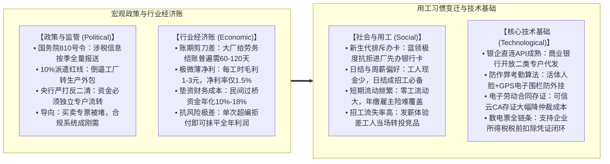
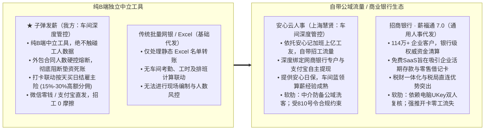
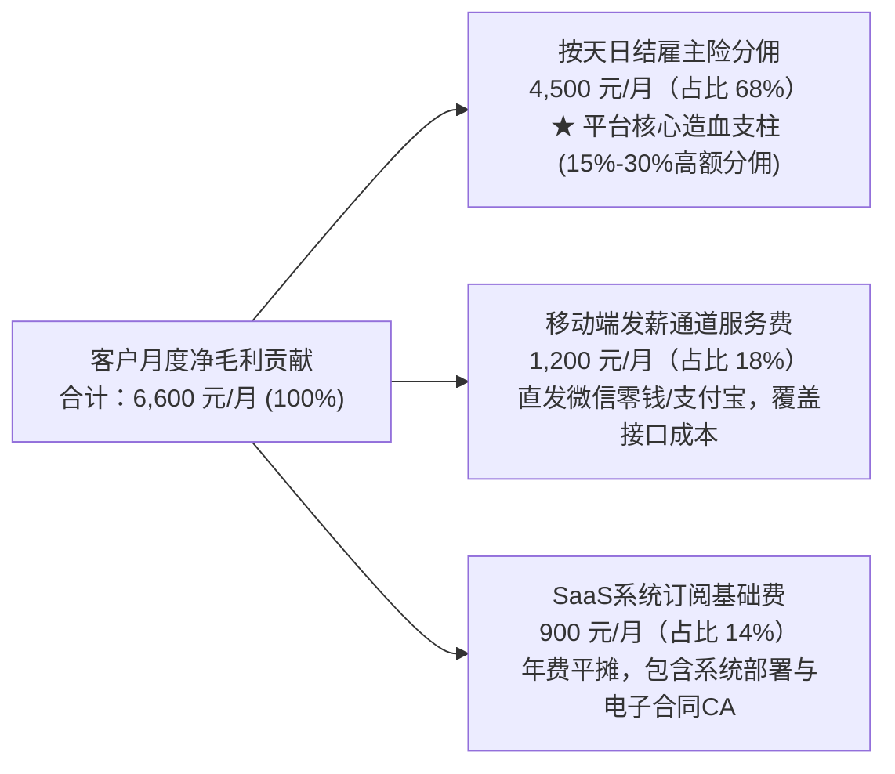
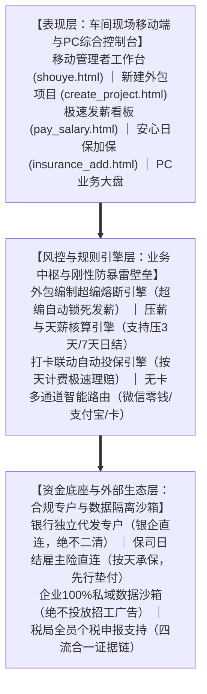
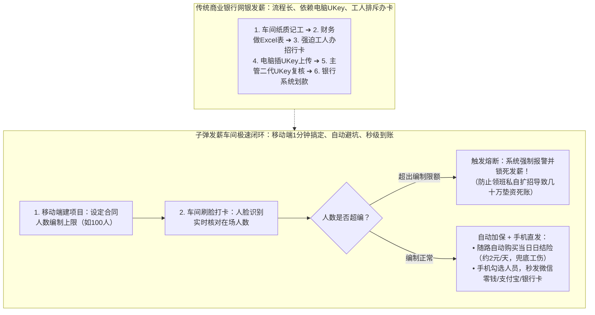

# 子弹发薪 vs 招商银行薪福通 vs 安心云人事 竞品分析报告

> **报告版本**：v2.0（业务实操与战略对标）  
> **对标对象**：子弹云 · 子弹发薪（苏州蓝豚跃动）、招商银行 · 薪福通（7.0）、安心云人事（上海慧贤 / 安心记加班）  
> **更新时间**：2026年10月  
> **分析重点**：发薪与资金合规（无卡发薪/专户/810号令）、车间外包现场管理（项目编制/考勤算薪/日结保险）、商业模式与盈利逻辑（通道费/保险分佣/银行存款沉淀）

---

## 业务背景与核心判断

国内蓝领外包与灵活用工的账面流水虽然庞大，但长三角（昆山、苏州、无锡等）和珠三角（东莞、深圳、佛山等）几万家中小型劳务中介过得并不宽裕。**这批企业的综合毛利率通常在 3%-5% 左右，算上垫资利息和工人退工折损，净利润率往往在 1.5% 上下徘徊**。

劳务公司对单纯的人事审批或打卡软件没有多少付费意愿。发薪赛道上的三家代表产品，各自切入市场的底层逻辑截然不同：

1. **招商银行 · 薪福通（银行的“存款与 AUM 抓手”）**：
   * 依托招商银行的金融科技与信誉背书，全国累计注册企业客户已达 **114.12 万户**（招行年报披露口径）。
   * 招行推薪福通不是为了赚 SaaS 软件费，主要是为了沉淀企业对公低成本活期存款，同时把工人工资卡转成招行个人客户，拉动后续的信用卡、理财和消费贷款（AUM）。
   * 局限在于：银行标准的网银 UKey 双人复核、必须开立招行卡的要求，在工厂车间很难落地。流动工人不愿意为了干几天活特意去办卡，领班也很难在下班后守着电脑逐一审批日结。
2. **安心云人事（自带流量的平台型方案）**：
   * 母体“安心记加班”App 积累了上亿蓝领用户，并拿到蚂蚁金服与顺为资本数亿元投资。
   * 产品在移动端领日薪、网商银行专户划转、快手快聘公域招工上确实打磨得比较顺畅。
   * 核心阻力在于**劳务中介对“公域洗客”的防备心理**：有一定流水规模的劳务老板，很担心自己花返费招来的工人被平台沉淀到公域池，转头推给别家出价更高的中介。此外，《互联网平台企业涉税信息报送规定》（国务院令第810号）施行后，平台撮合型业务的税务合规要求也在大幅提高。
3. **子弹云 · 子弹发薪（我方：做中立的驻厂风控与发薪工具）**：
   * 坚持**纯 B 端工具定位**，明确承诺不触碰工友个人数据、不在工人端投放招工广告，数据全部归劳务公司所有。
   * 针对劳务老板最怕的两个硬伤做深做透：第一，通过原型中已落地的**“外包合同人数编制硬控”**，在生成发薪批次时拦截超编招人，防止因工厂拒认工时产生几十万元垫资死账；第二，打卡时按天联动投保**“日结雇主责任险”**，花小钱化解工伤工亡风险。
   * 盈利上，通过 **15%-30% 的日结险佣金分成**，让平台在单笔发薪通道费微利的情况下，依然拥有稳定的造血能力。

---

## 第一部分 行业环境与痛点分析

### 一、宏观环境（PEST 框架）



#### 1. 政策环境（Political）
* **国务院令第810号《互联网平台企业涉税信息报送规定》规范涉税链条**：
  新规要求互联网平台企业按季度向税务机关报送平台内从业人员身份信息及上季度收入信息。以往灵工行业通过虚开经营所得专票赚取 5%-7% 灰色差额的打法基本走不通了。市场正在回归“中立软件系统 + 企业开立专户自主申报”的正规轨道。
* **10% 劳务派遣比例红线倒逼外包化**：
  受派遣比例不得超过企业总用工人数 10% 的规定限制，大型制造工厂和物流转运中心普遍将装配线、打包班组以“产线外包”形式交给劳务公司承接。在外包合同下，现场管理责任、工伤赔偿责任和工资垫付完全落在劳务中介头上，对车间现场考勤和人数的精细化管控变得十分迫切。
* **反二清与资金清算要求**：
  央行对无证支付机构沉淀资金池保持严监管。发薪平台不能当资金二道贩子，必须通过商业银行或合规持牌机构开立专用代发账户，实行封闭清算。

#### 2. 经济环境（Economic）
* **大厂账期拖延与垫资压力**：
  制造代工厂给劳务公司的结款周期通常在两到四个月，但工人的日薪或月薪一到期就必须发放，否则容易引发停工堵门。劳务公司大多依靠自有资金或民间过桥资金垫付，资金链崩得很紧。
* **薄利经不起坏账**：
  劳务外包行业靠赚取每人每小时 1-3 元的工时差价过活。一旦车间超编几十人导致工厂月底拒付工时费，或者出现一名工人工伤未投保，单次赔付几十万元就能把劳务公司一两个季度的微薄利润全部吞掉。

#### 3. 用工习惯（Social）
* **年轻蓝领对指定银行卡极其抵触**：
  年轻一代零工进厂前如果被要求专门去某家银行排队办借记卡，不少人会转头去别家。招工现场需要支持微信零钱、支付宝或工人随身已有的任意银行卡直接收款。
* **即时兑现偏好**：
  很多工人日常手头资金有限，对月结缺乏耐心，“压几天日结”或“周薪”已经成为劳务招工的常规手段。

#### 4. 技术环境（Technological）
* 商业银行与网商银行等机构的代发接口全面开放，使得第三方 SaaS 可以不碰资金完成指令下发；
* 活体人脸识别、GPS 围栏以及针对虚拟定位软件的检测算法已经相对成熟，能够有效防范代打卡作弊；
* 手机端签署电子劳动合同配合可信第三方 CA 认证，为用工仲裁提供了完整的证据链。

---

### 二、竞争态势与定位坐标



当前蓝领发薪赛道不再是简单的网银转账工具之争，而是**谁能真正帮劳务老板守住利润线、防住坏账和事故**。
* 招行薪福通在资金合规与财务一体化上有天然优势，但缺少车间现场的非标管控；
* 安心云在蓝领端的操作体验和招工协同很强，但平台公域属性让中介始终心存顾虑；
* 子弹发薪的差异化在于做深“驻厂风控”，把“超编垫资死账”和“未保工伤返贫”两个要命点卡死。

---

## 第二部分 竞品选择与多维横向对标

### 一、标的选择说明

| 竞品名称 | 阵营与背景 | 代表特征 | 选入对标理由 |
| :--- | :--- | :--- | :--- |
| **招商银行 · 薪福通** | 头部股份制商业银行体系 | 软件免费、资金合规性强、深绑招行借记卡与网银 | 劳务中介常接触的免费大行产品，需清晰界定其在车间场景下的落地盲区 |
| **安心云人事** | 垂直蓝领数字化服务商（慧贤/安心记加班） | C端流量大、蚂蚁顺为参投、成熟的日薪申领与专户直清 | 蓝领领域知名度高、功能完整的直接对手，需重点对比其模式利弊与信任摩擦 |
| **子弹云 · 子弹发薪** | 聚焦劳务外包现场的纯 B 端服务商 | 编制硬控熔断、打卡联动日结险、纯中立私域定位 | 我方基准产品，验证车间风控与保险盈利的可行性 |

---

### 二、商业模式画布（9 要素对比）

| 画布要素 | 招商银行 · 薪福通 (7.0) | 安心云人事 (上海慧贤) | 子弹云 · 子弹发薪 (我方) |
| :--- | :--- | :--- | :--- |
| **1. 客户细分** | 大中型企业、事业单位、科技园区企业、规范化人力集团 | 蓝领劳务派遣公司、短期日结中介、外包门店、灵工承包方 | 制造业/装配/注塑外包车间、物流分拣承包商、中小劳务中介、工头组织 |
| **2. 价值主张** | 人财事税一体化；银行级安全结算；免费数字化管理支持 | 蓝领一键发日薪周薪；网招高效获客；安心记加班求职生态直通 | **“绝不碰你的人，保住你的利润”**：防项目人数超编拒付；打卡自动买日结险防工伤返贫；微信/支付宝无卡秒到 |
| **3. 渠道通路** | 招行全国分行与支行对公/对私客户经理直推；总行企事业单位合作 | 快手快聘线上联运、蓝领求职市场推广、华东/华南中介圈口碑 | 昆山、东莞劳务市场地推走访；工头带工小程序裂变；保险经纪渠道分成 |
| **4. 客户关系** | 银企一揽子综合金融服务关系，由对公与零售经理共同服务 | SaaS 软件订购与流量合作关系；客户对平台招工有依赖，对洗客有戒心 | 中立的服务软件与风控工具，承诺数据资产完全归劳务企业所有 |
| **5. 核心资源** | 银行牌照与清算系统、全国实体网点、庞大的对公对私客群盘子 | 安心记加班 1 亿+ 工友流量池、蚂蚁金服资金专户支持、招聘合作资源 | 贴合车间作业的高保真原型、灵活发薪通道、高佣金日结险保司合作资源 |
| **6. 关键业务** | 薪福通平台研发迭代、对公账户拓展、零售个人代发工资沉淀转化 | 安心记加班用户促活、企业发日薪专户清算、安心日保研发、网招运营 | 车间考勤与编制熔断机制维护、无卡发薪通道打通、按天雇主险极速申报与理赔支持 |
| **7. 重要伙伴** | 国家税务总局系统、地方产业园、主流协同办公平台 | 网商银行、支付宝、快手快聘、众安及中华联合财险 | 合作商业银行结算专户、平安/太平洋等财产险保司、权威 CA 存证机构 |
| **8. 成本结构** | 银行科技研发中心研发开支、地面推广与网点维护成本（由全行业务统筹） | C 端工友促活与拉新成本、SaaS 服务器与系统维护费、合规审查开支 | 核心研发团队开销、区域本地销售与实施服务提成、CA 与支付接口费 |
| **9. 收入来源** | **不在软件上直接赚钱**：沉淀低成本对公活期存款；撬动个人借记卡开立及理财/贷款息差（AUM） | SaaS 系统年费、发薪通道手续费（按人/按笔收取）、安心日保分佣、网招佣金抽成 | **SaaS 软件服务费 + 移动发薪通道费（微利） + 按天日结雇主险渠道分佣（15%-30%）** |

> **商业逻辑剖析**：
> 招行薪福通以免费策略跑马圈地，其目标是存款和零售金融资产，不会专门为中小型劳务中介定制车间现场规则。
> 安心云试图把招工流量与管理软件打通，但商业闭环中同时包含招聘撮合与中介管理，容易让中介担心核心工人资产流失。
> 子弹发薪避开招工撮合，专注车间风控，依靠日结险的高分成形成自身造血，商业利益与劳务中介始终保持一致。

---

### 三、产品定位与场景特征对比

| 对比维度 | 招商银行 · 薪福通 | 安心云人事 | 子弹云 · 子弹发薪 |
| :--- | :--- | :--- | :--- |
| **产品 Slogan** | 一站式人财事数字开放平台 | 蓝领数智化人事与发日薪系统 | 专为劳务外包打造的智能发薪与风控中枢 |
| **核心受众** | 规模型企业、HRD、财务总监、白领员工 | 劳务中介负责人、日结门店主管、蓝领工人 | 劳务外包老板、车间驻厂经理、带班工头 |
| **典型作业场景** | 月度正规薪资计算、考勤假期审批、自然人税局申报、报销入账 | 临时工日结周薪在线申领、门店扫码入职、安心日保投保 | 车间分派项目工单、刷脸考勤防作弊、无卡批量直发微信零钱/支付宝、打卡按天加保 |
| **工人工资卡门槛** | 必须持有或新办招行卡（跨行代发录入信息繁琐），不支持无卡发放 | 工人自主提现到支付宝或 387 家银行卡，中介无需提前逐一录卡 | **完全无卡发薪**：凭姓名加身份证即可发起，资金直达微信零钱、支付宝或任意银行卡 |
| **工人数据归属** | 转化为招行个人零售卡客户 | 工人沉淀于安心记加班公域池，可能看到同厂其他中介更高价招工广告 | **数据完全私有**：不向工人推招工广告，不为外部平台引流 |

---

### 四、财务账本拆解（Unit Economics）



以一家**在职 500 名蓝领外包工人**的中型劳务中介为例，测算各产品的单客收益表现：

#### 1. 招商银行薪福通的账目表现
* **软件与通道收入**：0 元（系统免费使用，招行卡代发免手续费）。
* **银行内部价值**：
  * 该客户每月约 300 万元工资流水，在招行对公账户沉淀几天，形成几十万元的活期存款底盘；
  * 带来几百张新开借记卡，后续带动个人理财、信用卡透支或信用贷款利息收入。
* **研判**：对商业银行是一笔合算的获客买卖，但无法支撑第三方软件团队的独立运转。

#### 2. 安心云人事的账目表现
* **SaaS 软件年费**：通常在 3,800 - 6,800 元/年左右；
* **通道服务费**：按笔或按人收取 0.3 - 0.8 元，每月日薪累计发放几千笔，月通道毛利约 1,000 - 1,800 元；
* **安心日保分佣**：按天计费，月度保费数千元，按比例获得分佣；
* **网招撮合分成**：提供招聘线索撮合抽成。

#### 3. 子弹云 · 子弹发薪的财务支撑逻辑
* **基础 SaaS 年费**：3,000 - 5,000 元/年（覆盖系统部署、CA 合同签署及服务器成本）；
* **发薪通道服务费**：直发微信零钱或支付宝，单笔收取 0.5 - 1 元服务费，月均贡献约 1,500 - 2,500 元；
* **按天日结雇主险分佣（核心造血来源）**：
  * 制造与物流车间多属于 3-4 类工种，单人单日雇主险保费通常在 **1.5 - 2.5 元/天**；
  * 500 人在职项目中，日均投保约 350 人，单月产生有效投保约 9,000 工日；
  * 月度保费规模：`9,000 工日 × 2.0 元 = 18,000 元`；
  * 合作保司给到平台的渠道科技服务费通常在 **25%** 左右；
  * **单家客户带来的月度保费净分佣**：`18,000 元 × 25% = 4,500 元/月`，**年化贡献利润约 54,000 元**。
* **财务测算总结**：
  日结险分佣占到平台单客综合利润的 **65% 以上**。它把劳务老板最怕的工伤事故用较低门槛（一两天两三块钱）给兜住了，同时也为平台跑通了不依赖通道费补贴的健康现金流。

---

### 五、产品功能矩阵对比（KANO 需求模型）

依据 KANO 模型，功能划分为：**基本型需求（必不可少的基础门槛）**、**期望型需求（做得越好体验越佳的主战场）**、**兴奋型需求（形成明显差异化的突破点）**。

#### 1. 核心功能对标清单

| 功能分类 | 细分功能点 | KANO 分类 | 招商银行薪福通 | 安心云人事 | 子弹云 · 子弹发薪 | 落地依据与原型映射 |
| :--- | :--- | :--- | :--- | :--- | :--- | :--- |
| **发薪与通道能力** | 跨行银行卡批量代发 | 基本型 | 优秀 (支持300+银行) | 良好 (支持387家银行) | 良好 (银企通道对接) | `pay_salary.html` |
| | **无卡发薪（直发微信零钱/支付宝）** | **期望型** | 不支持 | 优秀 (网商专户/支付宝秒领) | 优秀 (支持微信零钱/支付宝) | `pay_salary.html` |
| | 日结/周薪/压薪自由设定期限 | 期望型 | 偏弱 (偏向按月标准发) | 优秀 (日薪周薪体系完善) | 优秀 (支持自由设压薪天数) | `create_project.html` |
| | 移动端一键算薪与发起 | 期望型 | 偏弱 (依赖网银UKey) | 良好 (App端操作通畅) | 优秀 (手机端快速勾选结算) | `pay_salary.html` |
| | 税局系统一键报税一体化 | 期望型 | 优秀 (直连自然人电子税局) | 一般 (导出标准税表) | 一般 (导出合规申报数据) | 官方功能 |
| **车间现场管控** | **外包合同人数编制强控熔断** | **兴奋型** | 缺失 (仅白领编制) | 较弱 (有统计但无刚性阻断) | **具备 (超出合同限额自动报警并阻断发薪)** | `create_project.html` |
| | 需打卡 / 免打卡双模式切换 | 期望型 | 较弱 (多为固定排班) | 良好 (打卡规则较规范) | 优秀 (项目维度自由切换) | `create_project.html` |
| | 白夜班与车间非标杂项折算 | 期望型 | 一般 (适合规则薪资) | 良好 (蓝领工时折算较全) | 优秀 (内嵌计件与杂费扣除) | `project_detail.html` |
| | 人脸防作弊与防虚拟定位 | 基本型 | 良好 (硬件考勤机/定位) | 优秀 (防作弊算法成熟) | 良好 (人脸识别与电子围栏) | `shouye.html` |
| **日结保险机制** | **按天投保日结雇主责任险** | **兴奋型** | 缺失 (仅有年缴/月缴团体险) | 良好 (提供安心日保接口) | **优秀 (打卡即时加保与快速报案)** | `insurance_add.html` |
| | 批量加保与外包名单同步 | 期望型 | 较弱 (需手动批单调整) | 良好 (批量名单导入投保) | 优秀 (发薪项目人员自动带出) | `pc_insure_daily_ax.html` |
| | 出险现场拍照呼叫预先报案 | 期望型 | 较弱 (线下理赔周期长) | 一般 (线上材料提报) | 优秀 (端内一键呼叫与现场拍照) | `insurance_detail.html` |
| **用工契约合规** | 手机端 1 分钟扫码签电子协议 | 基本型 | 良好 (直连可信CA) | 良好 (扫码入职签署) | 优秀 (可信云CA认证防篡改) | `contract_create.html` |
| | 年龄限制与到期预警 | 期望型 | 一般 (基础人事提醒) | 良好 (年龄校验拦截) | 优秀 (限定15-65周岁合规门槛) | `insurance_add.html` |

---

#### 2. 综合能力雷达评分（1-5分制）

```
车间发薪与现场管理能力对标打分

                  招行薪福通   安心云人事   子弹发薪 (我方)
资金通道权威性    █████ (5)    ████  (4)    ████  (4)
微信支付宝无卡发放 █     (1)    █████ (5)    █████ (5)
外包超编风控拦截  █     (1)    ██    (2)    █████ (5)
按天日结保险闭环  █     (1)    ████  (4)    █████ (5)
劳务私域信任度    ███   (3)    ██    (2)    █████ (5)
税财票一体化深度  █████ (5)    ███   (3)    ███   (3)
车间移动操作便捷性 ██    (2)    ████  (4)    █████ (5)

评分说明：
█ = 1分   ██ = 2分   ███ = 3分   ████ = 4分   █████ = 5分
```

* **评分要点**：
  * **招行薪福通**在资金清算与税务对接上规格最高，但在车间现场急需的无卡发放、编制强控与日结险上并不适用；
  * **安心云人事**综合表现平稳，但在私域流量防备与超编刚性拦截上留有短板；
  * **子弹发薪**贴合外包车间场景，在防超编坏账、日结险兜底和无卡发放上形成了自己的核心壁垒。

---

### 六、系统架构与业务流转路径

#### 1. 子弹发薪分层架构说明



#### 2. 发薪实操路径对比（子弹发薪 vs 传统银行网银）



* **流程差异**：
  传统薪福通走的是标准企业网银审批流，环节多、依赖电脑和硬件 UKey，日结工晚上下班结算时往往很难配合；
  子弹发薪在发薪前直接卡住超编人数，打卡同时给工人上了保险，最后通过手机端直发微信零钱，流程更符合车间晚间结款的操作习惯。

---

### 七、团队基因与组织策略

| 观察维度 | 招商银行 · 薪福通 | 安心云人事 | 子弹云 · 子弹发薪 |
| :--- | :--- | :--- | :--- |
| **团队基因** | 银行总行研发团队与金融机构规范，严守风控底线，但对车间一线的繁琐细节缺乏直观感知 | 互联网公司背景，长于 C 端运营和线上地推，懂蓝领心理，产品更迭节奏快 | 扎根昆山花桥等劳务聚集地，团队熟悉劳务外包各环节规则，能摸准中介老板的真正关切 |
| **资本策略** | 由招行内部科技经费全额支持，主要考核对公存款沉淀和零售拓客指标 | 获得蚂蚁金服与顺为资本联合投资，注重蓝领招聘与用工平台的整体规模估值 | 依托自有业务造血，重在维持日结险分佣的稳定现金流，不追求虚高的流量指标 |
| **市场打法** | 依托招行对公客户经理在各地企业客户中配套推广 | 依靠快手快聘合作引流、安心记加班导流与行业展会推广 | 扎根劳务园区地推、依靠熟人带班裂变，用“防超编、买保险”的实际收益打动客户 |

---

## 第三部分 综合研判与战略建议

### 一、SWOT 态势分析与应对策略

| | 优势（Strengths） | 劣势（Weaknesses） |
| :--- | :--- | :--- |
| **内部因素** | **S1. 纯中立无广告**：不染指劳务公司的工人资产<br>**S2. 车间编制硬控**：防止超编招人导致的垫资坏账<br>**S3. 打卡联动日结险**：15%-30% 分佣提供稳固利润<br>**S4. 微信零钱无卡秒发**：解决招工办卡阻力 | **W1. 资本规模与品牌名气**：相比大行和头部平台较弱<br>**W2. 财税直连深度**：税务自动申报功能仍在完善中<br>**W3. 个人金融服务**：缺少个人信贷等衍生增值服务 |
| | **外部机会（Opportunities）** | **SO 策略（发挥优势抢抓机会）** | **WO 策略（利用机会弥补不足）** |
| **外部因素** | **O1. 国务院810号令严管平台税收**：促使企业寻找正规合规软件<br>**O2. 劳务对公域洗客防备提升**：中立系统接受度提高<br>**O3. 制造外包比例上升**：现场防超编管理需求增加 | • 主打“中立工具+不碰工人数据”，承接从撮合平台流出的中大型劳务中介（S1+O1+O2）<br>• 在昆山、东莞劳务集中地推广“编制拦截 + 日结险”的一体化方案（S2+S3+O3） | • 借合规要求，联合区域农商行/城商行推联名专户，借银行品牌补充资质（W1+O1）<br>• 对接成熟第三方财税模块，补强个税自动申报能力（W2+O1） |
| | **外部挑战（Threats）** | **ST 策略（运用优势应对挑战）** | **WT 策略（针对弱项做好防范）** |
| | **T1. 银行系统持续免费**：招行等银行维持零软件费<br>**T2. 通道费可能面临价格竞争**：单笔费率被压缩<br>**T3. 蓝领日结险赔付率若上升**：保司可能调整核保门槛 | • 避开银行擅长的通用白领发薪，专做银行顾不上的车间超编与打卡日保（S2+S3+T1）<br>• 通道费只求保本，主要靠日结险分佣实现利润支撑（S3+T2） | • 接入多家财产险保司，分散单家保司政策调整的经营风险（W3+T3）<br>• 严守资金流不入自身账户的红线，防范清算合规风险（W1+T1） |

---

### 二、三大产品核心特征定性对比

| 核心维度 | 招商银行 · 薪福通 (7.0) | 安心云人事 (上海慧贤) | 子弹云 · 子弹发薪 (我方) |
| :--- | :--- | :--- | :--- |
| **根本意图** | 吸收企业存款，做大个人零售金融资产 | 扩大蓝领流量池，做大招聘和用工生态撮合 | **做深车间现场管理，靠日结险分佣造血** |
| **客户主要顾虑** | 资金虽然安全，但在车间现场落地很麻烦 | 招工虽然方便，但始终提防工人被分流 | **系统是自己的，能帮自己挡住坏账和赔偿** |
| **利润贡献来源** | 存贷利差与个人财富管理中间业务收益 | SaaS 年费 + 招工佣金抽成 + 通道费 | **按天日结险分佣 (15%-30%) + 基础 SaaS 费** |
| **发薪操作难度** | 较高（电脑网银 + 双人 UKey + 需开卡） | 较低（工人手机提现到支付宝或卡） | **很低（手机端直接输入姓名身份证直达零钱）** |
| **明显短板** | 缺少外包车间概念，没有防超编拦截机制 | 公域招工与中介私域之间存在信任冲突 | 暂未搭建全国性分支网点服务团队 |

---

### 三、产品规划与落地建议

#### 1. 功能推进步骤（分阶段实施）

* **【第一优先级：固化核心壁垒功能】**
  * **超编发薪阻断机制**：
    在 `create_project.html` 设定需求人数上限后，确保在 `pay_salary.html` 生成发薪单时进行强制校验。一旦在职勾选人数超过合同人数上限，系统必须弹出明确警示（提示“当前已超编 X 人，涉及潜在拒付垫资风险 Y 元”），并只允许拥有最高管理权限的老板输入动态验证码解锁，避免领班私下招工留下一堆坏账。
  * **日结雇主险“打卡加保与现场报案”顺畅化**：
    优化 `insurance_add.html` 与 `pc_insure_daily_ax.html`，实现工人早晨刷脸打卡后系统自动带出当日保单。同时在手机端保留“现场一键报案”通道，工人突发出险时，领班拍两张现场照片即可发起报案，让劳务老板和工人心态更踏实。
* **【第二优先级：合规凭证与地方银行通道】**
  * **税务凭证与工时打包导出**：
    配合国务院 810 号令，在后台提供包含电子劳动合同、每日刷脸考勤、发薪打款凭据、日结险保单的“全套外包证据包”一键导出，方便劳务公司应对监管检查。
  * **对接本地城商行代发通道**：
    避开全国性大行的繁琐流程，与昆山、常熟等蓝领集中地的本地农商行合作，嵌入银企直连子账户，保持合规的同时降低开户门槛。
* **【第三优先级：帮助中介自建熟人招工】**
  * 针对中介担心工人流失的心态，为主流中介开通“工头带工小程序”，支持老工人介绍新工人进厂后自动核算返费，帮中介盘活自己的熟人圈子，减少对外部平台的依赖。

---

#### 2. 销售实战应对思路（供一线参考）

##### 场景一：客户说“招行客户经理免费送我一套薪福通，你们为什么还要收钱？”
> **参考回答**：
> “老板，招行薪福通确实是大行产品，但那是设计给写字楼白领按月发工资用的。您车间里那些干三五天的日结工，您让他去招行排队办张卡，人家当场就去隔壁中介了。而且晚上十点车间结算，招行必须您回到电脑前插着两只 UKey 做双人审批，您天天跑得过来吗？
> 最要紧的是，招行系统不会管您跟厂里签的合同到底是派 80 人还是 100 人。领班要是私下招了 110 人，多出来那 10 个人的工资您垫出去就是几万块坏账，厂里根本不认。我们子弹发薪只要超一个人，系统立刻拦截不让发；而且工人报个身份证和名字，钱一秒打进微信零钱。我们收您几千块年费，只要帮您挡住一次超编垫资，就把这一两年的系统费全省出来了。”

##### 场景二：客户说“我们用安心云挺顺手的，还能在快手招人，为啥要换？”
> **参考回答**：
> “老板，安心云做日薪确实早，但您算过一笔账没有：您花钱大巴车从老家拉来的工人，用安心记加班打卡，手机端里会不会看到别家劳务每小时多给两块钱的招工广告？您辛苦招来的人，很容易被平台推给别人。
> 我们子弹发薪一开始就把这条写进协议：纯 B 端工具，系统里绝不推招工广告，绝不碰您的工人数据。另外我们系统自带按天买的日结工伤险，一人一天两块钱，工人要是碰伤骨折，现场拍照保司就能介入预赔，不用您自掏腰包赔几十万。工人留在您自己手里，利润也能保住，这才是稳当买卖。”

---

### 四、需要留意的外部动态

1. **观察招行薪福通在第三方支付接口上的态度**：留意其是否会放开直接代发至微信零钱或支付宝（短期内看概率不大，这与银行沉淀活期存款和拓展零售借记卡的初衷相冲突）；
2. **跟进安心云在税务监管下的模式调整**：关注其应对 810 号令后在灵工撮合上的业务比重，观察其是否会收缩公域撮合、转向纯私域管理；
3. **跟踪主流财险保司在蓝领日结险上的核保政策**：持续关注平安、太保等保司在制造业高风险工种上的赔付率，确保日结险保费与平台 15%-30% 的分佣比例维持在健康区间。
