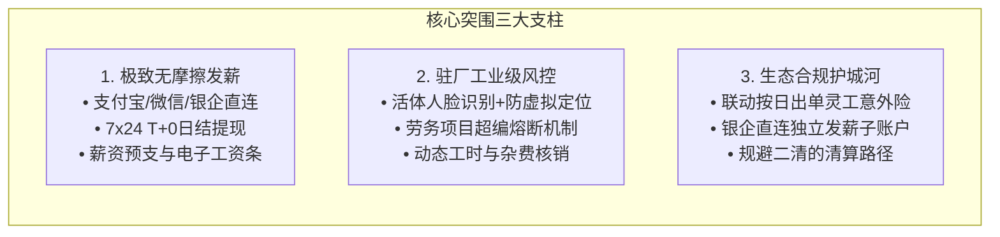

# 子弹发薪竞品分析报告：垂直灵工SaaS（安心云）与银行代发体系深度对标

---

## 报告摘要（Executive Summary）

在人力资源外包（BPO）、劳务派遣、蓝领制造及灵活用工场景下，**“发薪”**不仅是简单的资金通道划转，更是串联“招工获客、现场驻厂、考勤防刷、日结/周结结算、电子合同、灵工商保及税费合规”的业务中枢。

当前市场呈现出明显的分化与融合趋势：
1. **以“子弹发薪”为代表的劳务精细化管理SaaS**：聚焦劳务派遣公司与驻厂项目，主打按项目分组、超编管控、无卡发薪与日结保险。
2. **以“安心云（安心云人事）”为代表的蓝领生态闭环SaaS**：依托母体庞大蓝领社群（安心记加班）流量，主打“招工引流+移动考勤+无卡发日薪周薪”一体化。
3. **以“招商银行薪福通 / 工商银行工银薪管家”为代表的银行系代发平台**：依托金融牌照、全额资金托管与零费率优势，强势切入业财税人事数字化，但在高频日结、非标考勤、驻厂分组及无卡发薪场景存在天然痛点。

---

## 第一章 发薪赛道竞品全景图谱

发薪及薪资结算市场可以划分为四大主要派系，各派系的基因、客群与壁垒如下表所示：

```mermaid
quadrantChart
    title 发薪产品市场定位矩阵
    x-axis 传统白领全职用工 --> 蓝领派遣与灵活用工
    y-axis 工具型/资金通道 --> 业务全流程闭环SaaS
    quadrant-1 垂直蓝领SaaS (安心云、子弹发薪)
    quadrant-2 综合HR SaaS (薪人薪事、北森)
    quadrant-3 传统银行代发 (工行、建行网银)
    quadrant-4 数字化银行+灵工通道 (招行薪福通、微信/支付宝企业发薪)
    "子弹发薪": [0.82, 0.78]
    "安心云人事": [0.88, 0.86]
    "蓝鸟云": [0.75, 0.72]
    "招行薪福通": [0.42, 0.58]
    "工银薪管家": [0.28, 0.42]
    "传统银行代发": [0.18, 0.22]
    "薪人薪事": [0.25, 0.80]
    "薪宝科技": [0.70, 0.48]
```

### 1. 垂直蓝领/劳务派遣发薪SaaS（直接竞品）
*   **子弹发薪（子弹人力云 / 51zidan）**：面向劳务中介、派遣机构、蓝领制造业驻厂项目，主打无卡发薪、项目分组超编控制、日薪周薪与日结险。
*   **安心云人事（上海慧贤）**：依托“安心记加班”沉淀的海量蓝领C端池，主打“网招小程序引流 + 现场人脸/围栏防作弊打卡 + 无卡发日薪/周薪 + 薪资预支”。
*   **蓝鸟云（LanNiao）**：深耕酒店、餐饮、物流、会展灵活用工，聚焦多方协同排班、工时核算与众包结算。
*   **云薪资 / 劳务云 / 薪税保**：主打T+0秒级发薪至支付宝/微信、单笔极速下发与日结电子账单。

### 2. 银行系数字化发薪平台（间接但强势竞品）
*   **招商银行“薪福通”**：银行系SaaS天花板，集“智能算薪 + 个税算报缴一体 + 7×24小时代发 + 费控协同”，全面打通钉钉、企微、飞书生态。
*   **中国工商银行“工银薪管家”**：依托庞大对公基本盘与网点优势，打造“薪金卡、薪金通、薪金溢、薪金贷”个人金融闭环。
*   **平安银行“数字口袋 / 薪资代发”**、**微众银行“微众企业+”**：聚焦中小微企业与灵工场景极速开户发薪。

### 3. 灵工财税与众包结算平台
*   **薪宝科技（佣金宝）**、**众乐邦**、**众合云科（51社保/PEO）**、**用友薪福社**：侧重灵活用工身份转变（自由职业者合规转包）、委托代征、完税发票开具与四流一致监管。

### 4. 综合人事与薪酬SaaS
*   **薪人薪事**、**北森**、**KNX**、**BIPO**：针对中大型企业标准工时、全职员工五险一金复杂算薪、年终奖计税，较少涉及劳务外包和高频日结。

---

## 第二章 核心标的深度剖析

### 2.1 子弹发薪（子弹人力云）
*   **厂商背景**：苏州蓝豚互动 / 子弹云生态，专注人力资源中介、劳务派遣和灵活用工场景。
*   **核心功能矩阵**：
    1.  **无卡发薪**：免去员工办银行卡流程，直连移动支付或自有专户快速提现。
    2.  **劳务项目与派遣分组**：支持按照上游派遣单位、驻厂项目进行分组，支持设置项目人数编制红线，**超编自动预警与拦截**。
    3.  **多周期算薪与群发**：支持日薪、周薪、月薪等复合规则计算，一键生成并批量下发电子工资条。
    4.  **生态配套**：内置GPS/电子围栏考勤打卡、电子劳动合同签署、蓝领专属“日结保险”（降低单日工伤风险）及薪资预支。
*   **产品痛点与不足**：
    *   在前端招聘获客、简历开源上缺乏自有原生C端流量池；
    *   品牌知名度相较安心云与银行系较弱，大客户资质审查时信誉背书需补足；
    *   资金通道需依附于第三方支付机构或银行存管专户，抗监管波动能力较弱。

### 2.2 安心云（安心云人事）
*   **厂商背景**：上海慧贤网络科技有限公司，拥有国民级蓝领工具**“安心记加班”**（C端蓝领用户数千万级）。
*   **核心功能矩阵**：
    1.  **招工与私域裂变（杀手锏）**：提供蓝领网招微信小程序、招聘门店系统，打通快手“快招工”等外部生态，实现劳务中介“找人-锁人-入职”闭环。
    2.  **首创“发日薪/周薪”与无卡发放**：支持蓝领员工每日打卡后直接申领当日薪资，秒级直达微信/支付宝/银行卡。
    3.  **严密现场考勤与反作弊**：支持人脸比对打卡、GPS电子围栏，内置设备指纹防作弊风控，杜绝替打卡和虚拟定位。
    4.  **资金安全独立专户**：平台宣称“全程不碰资金”，资金通过企业独立专户划扣，保障合规。
*   **产品痛点与不足**：
    *   针对复杂BPO外包多级结算（如“企业-一级总包-二级转包-工头-工人”）的分润账单与权限链条配置相对通用，大体量劳务集团定制化成本高；
    *   依赖平台提供的金融分发通道，费率对中小劳务相对敏感。

### 2.3 银行代发薪资（以招商银行薪福通、工行工银薪管家为代表）
*   **厂商背景**：持牌商业银行，以对公资金归集、沉淀存款（AUM）、个人金融交叉销售为根本驱动力。
*   **核心功能矩阵**：
    1.  **业财税银闭环**：打通薪资计算、企业年金、个税直连申报缴款、银行系统自动逐笔转账。
    2.  **超高资金安全与零成本代发**：全流程银行级账务体系，企业同行代发基本**0手续费**，无“二清”合规质疑。
    3.  **员工金融增值服务**：代发工资卡员工可自动获得专享理财产品、更低利率的消费贷款（如工行薪金贷、招行闪电贷）。
    4.  **开放SaaS化（薪福通）**：提供费控报销、福利商城、人事考勤基础模块，支持与钉钉/企微打通。
*   **针对灵活用工/劳务派遣的致命痛点**：
    *   **强绑卡与开卡摩擦**：传统代发要求员工必须持有该行一类/二类借记卡。蓝领工人和临时工流动性极高（很多做几天就走），强迫办卡导致用工流失率极高。
    *   **结算频次滞后**：传统银行代发偏向按月批处理发放。面对“日结、下班结、周结”，需频繁发起对公代发经办与复核，UKey授权流程极度繁琐。
    *   **非标驻厂与防作弊缺失**：银行系统无法深入车间/工地，缺乏多段计件、工时扣减、驻厂合宿、伙食费水电扣缴等复杂杂费规则计算工具。

---

## 第三章 多维度横向对比矩阵

| 评估维度 | 子弹发薪 (51zidan) | 安心云人事 (YunRenShi) | 银行代发 (招行薪福通 / 工行) |
| :--- | :--- | :--- | :--- |
| **核心定位** | 劳务中介/派遣数字化发薪与驻厂管理 | 蓝领“招-管-发”全周期数字化平台 | 企业“人财税事”一站式金融数字化平台 |
| **目标客户群** | 劳务派遣公司、蓝领外包商、驻厂机构 | 制造业劳务商、连锁服务业、灵工中介 | 全类型企业，尤其中大型企业、国企、标准工时企业 |
| **开户与绑卡门槛** | **极低（无卡发薪）**：手机号/实名直接提现至支付宝等 | **极低（无卡发薪）**：直达支付宝/微信/已持有的任意卡 | **较高**：通常强制要求开立指定银行借记卡（一类/二类卡） |
| **结算频次与灵活性** | **极高**：支持日结、周薪、工时结算、薪资预支 | **极高**：主打每日打卡自助申领日薪、周结、月结 | **较低**：以月薪为主，日结需频繁通过网银批处理操作 |
| **招工与引流获客** | 较弱，主要提供基础导入与名单沉淀 | **极强**：背靠“安心记加班”生态、网招小程序、快手直聘 | 无原生招工能力，仅提供入职信息填报 |
| **现场与考勤管控** | GPS、人脸打卡、**派遣项目超编拦截** | GPS电子围栏、**人脸识别、反虚拟定位作弊引擎** | 基础考勤打卡，偏白领内外勤，缺乏严密工业级防刷机制 |
| **特殊配套服务** | **日结保险（按天投保）**、电子劳动合同 | 电子合同存证、薪资预支、招聘门店 | 员工理财、信用贷款（薪金贷/闪电贷）、团险 |
| **资金安全与合规** | 独立企业发薪专户，宣称“不碰资金” | 独立发薪专户通道，合规清算接口 | **最高安全等级**：银行直连自管账户，无资金二清风险 |
| **收费商业模式** | SaaS软件年费 + 发薪通道费/流水抽成 + 衍生保险抽成 | SaaS年费/按人头收费 + 支付通道费 + 招聘引流工具包 | **软件基础免费/极低**；核心盈利来自存款沉淀与个人金融转化 |
| **移动端易用性** | 驻厂经理App + 员工小程序，随时随地审发 | 劳务移动端 + 员工小程序，体验平滑快捷 | 网银端较重（依赖UKey与双人复核），移动App逐步普及 |

---

## 第四章 深度专题对决

### 4.1 焦点对决一：子弹发薪 VS 安心云（垂直灵工SaaS同维对抗）


#### 1. 流量与获客维度的碾压差：
*   **安心云的最大杀手锏在于“自带流量”**。安心记加班累积了上亿蓝领工人习惯，这使得劳务公司购买安心云人事不仅能“管人”，还能通过招聘小程序在工友圈裂变招工；
*   **子弹发薪更偏重“中后台管理”**。如果企业本身不缺工人来源，仅痛在驻厂人员管理、工时统计和发薪对账，子弹发薪的纯管理属性性价比更高。

#### 2. 项目防超编与驻厂精细化：
*   劳务派遣行业最大的财务风险之一是**“项目人数超标，企业不认账导致垫资亏损”**。子弹发薪针对“按派遣单位建立项目分组”、“项目人数超编硬控拦截”做了专门的规则引擎设计；
*   在工业园驻厂多供应商并存的复杂场景下，子弹发薪在**多劳务项目拆分核算**的颗粒度上表现扎实。

#### 3. 风险缓冲手段：
*   灵工与临时工流动大、工伤概率高。子弹发薪深度嵌入了**“按天购买的日结雇主责任险/意外险”**，与发薪动作联动（打卡发薪即生效保单），切中了中小劳务老板最怕的工伤事故痛点；安心云则更注重“日薪申领体验”来稳定工人出勤率。

---

### 4.2 焦点对决二：子弹发薪/安心云 VS 银行代发薪资（跨界竞合与颠覆）

#### 1. 为什么银行代发在蓝领/灵工场景“屡屡碰壁”？
1.  **“办卡门槛”与“用工秒走”的矛盾**：
    *   蓝领日结工、暑期工、小时工流动频繁（7天内离职率可超40%）。去银行网点集中开卡甚至办电子二类卡，流程耗时，工人和劳务公司极度排斥；
    *   子弹发薪与安心云采用**“无卡发薪”**（直连微信零钱、支付宝或员工自持既有银行卡），实现了“上工入职即填、下工打卡即结”，极大降低履约摩擦。
2.  **“复杂非标算薪”与“标准批量转账”的断层**：
    *   银行代发本质是**资金执行通道**，虽然薪福通增加了算薪模块，但其算薪逻辑针对的是“基本工资+固定绩效+五险一金”，无法处理“白班18元/h、夜班21元/h、超产计件0.5元/件、扣除工作餐与宿舍水电费”的复杂车间规则；
    *   垂直SaaS在前端把工时、扣款核算完毕后直接生成付款指令，银行代发则需要HR在Excel手工算完后再导入网银。
3.  **“严密风控与UKey审批”与“现场日结秒发”的时效冲突**：
    *   银行对公转账强调“出纳经办+财务复核+主管审批+实体UKey防伪”，适合月度发薪；
    *   劳务日结发薪通常由驻厂领班或项目调度员在下班现场确认，SaaS支持移动端生物识别（人脸/指纹）即时放款。

#### 2. 为什么银行仍然是不可忽视的底层力量？
*   **绝对资金安全感**：劳务公司每月走流水几千万甚至上亿，将大量资金充值到第三方SaaS账户存在“爆雷、资金池挪用、二清暴击”的恐慌；
*   **资金成本与授信**：银行可基于代发流水向劳务公司提供**发薪备用金贷款、保理授信**，解决劳务公司需要垫资给工人的资金周转痛点；
*   **最终形态趋势：“被集成”**：
    未来格局并非垂直SaaS与银行你死我活，而是**“垂直SaaS做前台场景与算薪 + 商业银行提供底层虚拟户、存管与清算通道”**的深度融合模式。

---

## 第五章 自研/做对标发薪产品的核心策略与落地路径

如果您计划设计并推出一款对标“子弹发薪”或“安心云”的数字化发薪竞品，建议采取以下产品突围策略：



### 1. 必做核心功能（MVP基线）
1.  **无卡/极简账户体系**：
    *   员工端无需重开银行卡，通过手机号实名认证二要素/三要素，绑定既有微信钱包、支付宝或任意银行借记卡；
    *   支持**日薪自主申领**与**管理员一键批量代发**双模式。
2.  **劳务项目与防超编引擎**：
    *   支持建立“客户企业 $\rightarrow$ 派遣项目 $\rightarrow$ 班组 $\rightarrow$ 员工”多层级组织；
    *   设置项目合同编制上限，招募和考勤时超编即时熔断，防止劳务公司超额垫付。
3.  **工业级防作弊移动考勤**：
    *   GPS电子围栏 + Wi-Fi MAC地址探测 + 实时活体人脸检测；
    *   监测并拦截“分身软件、模拟器、FakeGPS”作弊行为。
4.  **薪资预支与电子工资条一键签收**：
    *   提供设定额度范围内的出勤预支，出具防篡改的电子工资单并强制移动端签字确认，化解劳资纠纷隐患。

### 2. 差异化与增值突破点
*   **日结保险一键随路投保**：打卡考勤成功即通过API向保险公司申报生成1日生效保单，未出勤不计费，将工伤风险转移出去；
*   **银行虚拟子账户直连（破解二清疑虑）**：对接招行、平安或网商银行等提供的企业发薪专户（跨行代发体系），资金不进平台账户，直接由银行在虚拟子账户之间定向划拨，彻底解决大中型劳务对“资金平台跑路”的顾虑；
*   **灵工佣金完税与个体户转包合规方案（可选模块）**：针对佣金类灵活用工，提供委托代征与完税发票接口。

---

## 结论速览表

*   **如果对标安心云**：核心补齐**前端工人获取转化（招工小程序）**与**防作弊考勤引擎**，强化对蓝领工人的粘性；
*   **如果对标子弹发薪**：核心做深**劳务派遣多项目管理**、**防超编机制**与**日结保单集成**；
*   **如果应对银行竞争**：不要与银行拼资金牌照与免息成本，做银行做不到的“现场驻厂工时规则、无卡T+0秒结、移动协同”，并将银行作为清算通道接入自身体系，实现“借力打力”。
