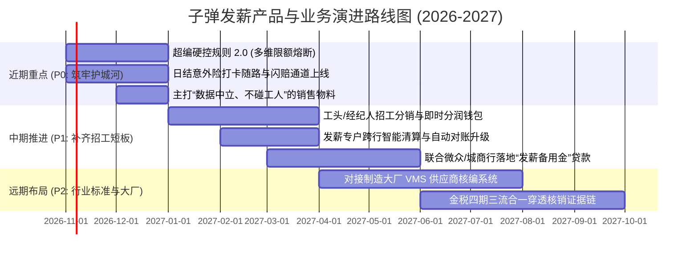

# 子弹发薪竞品分析与产品策略总报告

**——对比安心云人事、招商银行薪福通与微众企业+**

---

| 报告属性 | 详细说明 |
| :--- | :--- |
| **报告定位** | 供公司管理层、产品团队与一线商务使用的战略分析与业务打法内参 |
| **编写原则** | 遵循《自然中文协议》（去公关化、去机械排比、重实操细节与商业逻辑） |
| **对标对象** | **我方产品**：子弹云 · 子弹发薪（51zidan / 苏州蓝豚跃动）<br>**直接对手**：安心云人事（上海慧贤 / 安心记加班生态）<br>**传统银行**：招商银行 · 薪福通（CMB Xinfutong）<br>**数字银行**：微众银行 · 微众企业+（WeBank Enterprise+） |
| **更新时间** | 2026年10月 |

---

## 目录

1. [核心结论与业务判断](#核心结论与业务判断)
2. [行业基本面：劳务中介到底在为什么买单？](#行业基本面劳务中介到底在为什么买单)
3. [四家产品的底色与核心机制拆解](#四家产品的底色与核心机制拆解)
4. [核心能力对比总表与实操打分](#核心能力对比总表与实操打分)
5. [三场关键战役的攻防细节](#三场关键战役的攻防细节)
6. [账算下来到底赚不赚钱？——真实财务与业务账（Unit Economics）](#账算下来到底赚不赚钱真实财务与业务账unit-economics)
7. [子弹发薪接下来该怎么走？（产品演进与落地建议）](#子弹发薪接下来该怎么走产品演进与落地建议)
8. [销售一线实战话术与打法参考](#销售一线实战话术与打法参考)
9. [参考资料与信源说明](#参考资料与信源说明)

---

## 核心结论与业务判断

当前国内灵活用工和劳务派遣市场明面上流水很大（行业测算接近 1.9 万亿），但深入到长三角、珠三角几万家做蓝领外包和派遣的中小型劳务公司，会发现大部分老板过得非常紧巴。他们的毛利普遍只有 3% 到 5%，净利润能保住 1.5% 就算不错了。大厂给劳务公司的回款往往要拖两三个月甚至四个月，而车间工人的工资却必须按天、按周或按月准时结清。

在这样残酷的生存环境里，劳务老板对纯粹的人事管理系统或者漂亮的打卡软件其实没有多少付费意愿。发薪赛道上的几家主流产品，之所以能切入这个市场，逻辑完全不同：

```
                    【四家产品的市场切入路径】

      综合业务 SaaS
        │
        │                     【垂直赛道正面对决】
        │       安心云人事                      子弹发薪 (我们)
        │       (流量抓手型)                    (风控管控型)
        │       • 靠安心记加班沉淀大量工人      • 强控项目编制，超编自动拦截
        │       • 主打招工引流和日薪申领        • 打卡自动按天投保日结险
        │       • 劳务戒备其洗走私域工人        • 纯 B 端定位，承诺绝不碰工人
        │
        │       ─────────────────────────────────────────
        │
        │       招行薪福通                      微众银行·微众企业+
        │       (传统大行生态)                  (纯线上信贷驱动)
        │       • 免费SaaS吸引对公存款          • 微业贷秒级无抵押贷款解决垫资
        │       • 客户经理地推，同行转账免费    • 手机开户，支持微信零钱直发
        │       • 强推开卡，网银流程繁琐        • 缺乏车间算薪逻辑，本质是网银
        │
      转账与资金通道
        │
        └────────────────────────────────────────────────────────
          标准全职白领 ───────────────────── 制造外包与蓝领灵工
```

### 几个关键判断：

1. **面对安心云，打“中立与防亏”牌是我们的胜负手**：
   * 安心云最大优势在前端。依托“安心记加班”多年积累的工友基础和快手快聘的合作，确实能帮中介招到人，日薪领款也很顺滑；
   * 但安心云最大的软肋也在前端：母体做蓝领招聘和用工平台，有流水规模的劳务老板普遍提防它，害怕自己的工友被平台吸走，推给其他同行中介；
   * 子弹发薪的定位是**完全中立的纯 B 端工具**，绝不碰中介的工人。同时，我们死磕安心云做得不够深的车间风控——**“合同编制超编硬控”**（防垫资死账）和**“打卡自动买日结工伤险”**（防工伤破产），直接帮老板保住微薄的利润底线。
2. **面对银行，不要去硬碰资金牌照，做银行做不到的车间现场**：
   * 招行薪福通功能做得很全，资金也权威，但在县域工厂场景下，强迫流动工人新办招行借记卡，导致不少工人扭头就走；厚重的网银 UKey 双人审批也根本适应不了车间下班日结；
   * 微众银行靠“微业贷”一招鲜吃遍天，精准解决老板垫资发薪的现金饥渴，但它本质是个纯资金账户，车间里复杂的白夜班津贴、计件递进、水电住宿扣款，微众根本算不了；
   * 子弹发薪的最优策略不是替代银行，而是**“借银行的势，做车间前置层”**：前台负责最脏最累的排班、考勤防刷、非标算薪和超编拦截，后台对接银行的发薪专户或微业贷接口，大家各取所需。

---

## 行业基本面：劳务中介到底在为什么买单？

劳务派遣和灵活用工公司表面上是人力中介，本质上更像一家**承接车间非标管理并承担资金垫付周转的供应链服务商**。他们日常最怕的不是招人麻烦，而是以下四个会直接要命的环节：

### 1. 超编垫资变成死账（一次就能赔掉半年利润）
劳务公司跟富士康、立讯这类制造工厂签外包合同，每个项目都有严格的人数上限。比如合同约定该项目驻厂最多 100 人。如果车间领班现场管理混乱，为了赶工期招了 120 个人，工资是由劳务公司先行垫付给工人的。月底找工厂结账时，工厂只认合同内的 100 个人，多出来的 20 个人工成本（通常好几万甚至十几万），工厂一分钱都不会认。
由于劳务中介净利润率只有 1% 到 2%，一旦发生严重超编，这个项目这一两个季度等于白干，全贴进去了。

### 2. 突发工伤致残甚至猝死（老板一夜返贫）
冲压、注塑、装配以及物流搬运这些岗位，工伤发生率通常在 1% 到 2.5% 之间。临时工和日结工流动性很大，很多人只干几天就走，劳务公司很难去给每个人买几百上千元的传统年缴雇主责任险，因为退保换人手续非常麻烦。这就导致很多工人处于无保“裸奔”状态。
一旦车间发生断指、骨折甚至突发猝死，法定补偿金动辄几十万上百万。对于利润本来就薄的中小劳务公司来说，一次没投保的严重事故就足以让公司直接倒闭。

### 3. 垫资发薪的资金链断裂
制造业大厂回款普遍有 60 到 120 天账期，而工人的工资必须准时到账，拖欠两三天就可能引起罢工扯皮。劳务公司如果资金实力不够，只能借民间过桥资金，年化利息往往高达 10% 到 18%，等于把原本微薄的利润全送给了借贷方。他们对年化 4% 到 6% 的低息银行信贷有着极强的渴望。

### 4. 招工与留工摩擦
年轻一代蓝领工人手头普遍存不下多少钱，平时现金储备常在两三千元以下，对次月发薪这种长周期非常排斥，“日薪/周薪”已经成为劳务招工的核心卖点。同时，很多临时工非常反感为了干几天活专门去银行排队办新卡，如果要求办指定银行卡，很多人当场就放弃面试了。

---

## 四家产品的底色与核心机制拆解

### 1. 子弹云 · 子弹发薪（我方基准）
* **定位**：专门针对劳务外包、派遣项目和车间驻厂开发的管理与发薪系统；
* **核心打法**：
  * **超编硬控拦截**：系统直接绑定派遣合同编制人数。现场打卡或排班一旦超过上限，系统立刻报警并阻断发薪生成，从源头上杜绝超额垫资；
  * **考勤联动日结保险**：工人早上刷脸打卡成功，系统自动向保险公司报送当天保单，按天计费（通常 1 到 2 元/天），不上工不花钱，发生工伤在线闪赔；
  * **无卡灵活发薪**：通过企业独立专户，支持一键代发至微信零钱、支付宝或已有银行卡，支持日薪、周薪和计件工时混合算薪；
  * **纯 B 端定位**：不碰招聘撮合，不截留工人数据，数据完全归劳务中介独家所有。
* **主要短板**：没有面向普通工人的公域 App 流量大盘，中介招工主要靠自身私域沉淀。

### 2. 安心云人事（直接竞争对手）
* **定位**：依托“安心记加班”庞大蓝领用户群打造的“招工-考勤-管理-发薪”一体化平台；
* **核心打法**：
  * **自带 C 端流量池**：凭借安心记加班积累的数千万工人习惯，配套微信网招小程序，并打通快手快聘生态，帮中介拉新；
  * **打卡自主申领日薪**：蓝领工人在手机端随时查看并提取当天出勤工资，直达微信或支付宝，体验顺畅；
  * **现场考勤防作弊**：在人脸识别打卡、防虚拟定位外挂方面经验丰富。
* **主要短板**：
  * **私域流失顾虑**：平台本身有求职和灵工业务，规模中介很担心工友信息导入后被推荐到其他中介高价单上；
  * **项目精细化风控不足**：面对复杂的劳务转包、多项目编制硬控以及非标杂费扣缴，灵活性一般。

### 3. 招商银行 · 薪福通（股份制商业银行标杆）
* **定位**：招行面向企业客户推出的一站式人财事数字平台，核心目的是沉淀企业低成本对公存款，并转化个人零售 AUM；
* **核心打法**：系统功能非常全（人事、算薪、费控、协同），直连国家税务总局自然人电子税务局，算薪报税全自动，且行内代发完全免手续费；
* **主要短板**：
  * 强绑卡摩擦大：强推招行借记卡，流动工人往往不愿为了几天工专门跑网点办卡；
  * 流程过重：大额代发严重依赖电脑端网银和实体 UKey 双人复核，车间领班在现场很难处理高频下班日结；
  * 开户门槛高：严格的反洗钱尽调把很多无独立场地的轻资产小劳务挡在门外。

### 4. 微众银行 · 微众企业+（纯互联网数字普惠标杆）
* **定位**：腾讯发起的纯线上数字银行企业平台，以信贷和简易对公结算为抓手；
* **核心打法**：
  * 手机端极速开户，无需网点面签；
  * “微业贷”全线上无抵押授信，系统秒批秒放，直接解决小微劳务垫资发薪燃眉之急；
  * 深度集成微信生态，支持批量直发员工微信零钱。
* **主要短板**：完全没有车间考勤、非标复杂算薪和编制管理功能，本质上是一个支持零钱批量代发的高效移动资金账户。

---

## 核心能力对比总表与实操打分

### 综合横向对比

| 业务维度 | 子弹发薪 (我们) | 安心云人事 | 招商银行·薪福通 | 微众银行·微众企业+ |
| :--- | :--- | :--- | :--- | :--- |
| **主要获客抓手** | 中后台精细风控（超编防亏+日结险） | 前端招工引流（记加班+网招小程序） | 免费全套 SaaS + 直连报税 | 微业贷线上无抵押授信（垫资钱） |
| **开户与入驻门槛** | 线上提交资质，发薪专户快速审核 | 线上实名，发薪专户快速签约 | 需去网点、上门核验场地，耗时数天 | 手机人脸识别，无网点，最快当天开 |
| **工人工资卡限制** | **无卡发薪**（支付宝/微信/任意卡） | **无卡发薪**（支付宝/微信/任意卡） | **强绑卡**（强推开立招行卡） | **无卡直连**（微信零钱/跨行任意卡） |
| **发薪周期灵活性** | 极高（支持日结/周薪/下班秒发） | 极高（工人端每日打卡自主领日薪） | 偏月薪，日结依赖网银复核，流程重 | 高（支持导入表格批量发，秒到账） |
| **项目人数超编拦截**| **强力护城河**（编制红线刚性熔断） | 基础（仅有常规标签，无强力熔断） | 较弱（仅有白领定岗，无现场拦截） | 无（纯资金转账通道，无编制概念） |
| **车间日结意外险** | **深度内嵌**（打卡即保，按天计费） | 通用（提供常规雇主险接口） | 无（仅有年缴团体险） | 通用（提供外部保险产品货架） |
| **现场考勤防刷作弊**| 人脸识别、GPS定位、驻厂核验 | 人脸识别、反模拟器、电子围栏 | 基础内外勤打卡，车间防刷较弱 | 无考勤模块，需自行导入考勤数据 |
| **车间非标排班算薪**| 深度支持白夜班津贴、动态计件扣费 | 标准功能较全，复杂公式配置略烦琐 | 适合标准薪资，非标计件杂费计算弱 | 极弱（仅支持输入最终金额转账） |
| **数据中立与私域归属**| **绝对中立**（纯B端，绝不抢工人） | **存在顾虑**（涉足招聘，中介戒备） | 绝对中立（银行不干涉劳务招聘） | 绝对中立（银行不干涉劳务招聘） |
| **垫资借贷支持** | 需与外部银行合作授信 | 缺乏自营信贷，依赖外部合作 | 传统流动资金贷款，审批慢门槛高 | **压倒性优势**（微业贷秒批秒放） |
| **商业盈利模式** | SaaS年费 + **日结险高分佣(15%-30%)** | SaaS年费 + 招聘引流工具 + 通道费 | 核心赚取存款利差与个人财富AUM | 核心赚取贷款利息收益 |

### 业务综合评分（满分 10 分）

```
评估指标                 子弹发薪    安心云人事    招行薪福通    微众企业+
────────────────────────────────────────────────────────────────
车间现场风控与超编拦截      9.5         7.0          4.5          1.0
日结保险与工伤分摊能力      9.5         6.0          3.0          3.0
数据中立与私域资产安全      9.5         5.0          9.5          9.0
移动端无卡即时发薪体验      9.0         9.5          5.0          9.0
车间非标复杂算薪引擎        9.0         7.5          6.5          2.0
前端流量与招工裂变能力      6.0         9.5          3.0          5.0
业财税银闭环与官方资质      7.5         8.0          9.8          7.0
流动资金与信贷授信赋能      6.0         5.5          6.5          9.8
────────────────────────────────────────────────────────────────
综合实战均分                8.25        7.25         5.98         5.73
```

---

## 三场关键战役的攻防细节

### 第一战：面对安心云——攻其“私域戒备”，突出“超编与日保”

#### 1. 击打安心云的天然软肋：劳务公司的“流量戒备心”
安心云背后是做蓝领求职起家的安心记加班平台。劳务老板心里非常清楚，自己辛辛苦苦花招工返费拉来的工友，一旦全引流到安心生态里打卡，工友手机里就有了别人的入口。如果明天有同行在同一个区域开出更高工价，平台稍有动作，劳务公司的工人很可能就流失了。
**子弹发薪要反复强化纯 B 端中立定位**：我们不做求职撮合，不做劳务派遣，不给工人推招工广告，数据百分之百属于中介自己。对于手上管理着上千名工人的正规规模型劳务老板，这个点具有极强的杀伤力。

#### 2. 把“超编拦截”算成看得见的利润
很多车间领班因为现场缺人，容易私自放水多招人。大厂结算时卡死合同编制，多招 10 个人，一个月就是好几万元的纯垫资死账。
安心云有项目标签，但没有针对合同编制的强力熔断。**子弹发薪直接把超编做成刚性控制**：人数一满，系统直接锁死发薪和排班生成，必须经过劳务老板审批。这等于在车间一线为老板守住了钱袋子。

#### 3. 补足自身招工工具短板：做工头裂变，而不是自建 C 端
我们没有必要去砸钱烧一个 C 端的求职 App。劳务中介实际招工最管用的往往是“老乡带老乡”和“车间工头带班”。
子弹发薪应该推出极度顺手的**“工头裂变分销工具”**：给带班工头生成专属码，拉来的工友只要在工厂干满 7 天或完成首次发薪，系统自动把带工提成（比如 500 元/人，或者每工时提 0.5 元）结到工头的钱包里。用利益机制帮劳务公司调动起现场工头的积极性。

---

### 第二战：面对招商银行薪福通——做车间前置层，避免正面争夺账户

招行有全牌照和免费优势，但它很难真正把脚踩进县域工业区的车间烂泥里。
* 临时工今天来明天走，让工人专程去招行网点排队半天开卡，至少会流失两成求职者；
* 车间工人下班就聚在门口要钱，招行插上 UKey、财务做单、主管复核这套严密的网银流程，根本无法应付现场的高频日结；
* 招行网银也算不了车间多工序计件、白夜班不同单价以及水电宿舍的非标扣除。

**我们的策略是“被集成”**：我们不动客户在招行的对公专户，资金依然放在招行。子弹发薪作为前端系统，把工时核对、计件算薪、超编拦截这些杂活干完，最后生成一条合规的代发指令，一键推送到招行通道或者网银，把专业工具与银行资金打通。

---

### 第三战：面对微众银行微众企业+——联合信贷，各取所需

微众银行的“微业贷”切中了小微劳务垫资发薪的核心痛点。很多劳务老板为了获得这几十万到两三百万的流动资金贷款，愿意在微众开户。
但微众企业+只有转账功能，没有考勤排班和车间管控。
**我们的策略是做数据资产化对接**：子弹发薪沉淀了劳务公司最真实的项目外包合同、每日人脸打卡数据和历史发薪流水。我们可以联合微众银行或区域城商行，以平台上的真实考勤流水作为信用背书，给使用子弹发薪的劳务客户提供更顺畅的“发薪备用金”审批，把微众的信贷能力借过来赋能我们的客户。

---

## 账算下来到底赚不赚钱？——真实财务与业务账（Unit Economics）

### 1. 行业基本数据盘点
* 行业利润极薄：A 股龙头科锐国际的灵活用工业务毛利率长期只有 4.11%，中小型劳务公司的纯利通常在 1% 到 2% 之间。
* 账期与离职率双高：大厂账期 60 到 120 天，制造业普工年化离职率超 40%，工伤发生率在 1.2% 到 2.5% 左右。一旦发生死亡赔偿，法定补偿金超过 90 万元。

### 2. 单客户年化收益模型对比
以一家拥有 **2,000 名驻厂工人** 的中型劳务公司为例，对比纯发薪通道与子弹发薪全模块模式的实际产出：

```
                    【劳务中介单客户年化商业价值测算】

  测算基准：2,000名驻厂工人，月出勤25天，月发薪总流水约 1,000 万元
  ─────────────────────────────────────────────────────────────
  业务模式                 纯发薪通道模式 (传统打法)     子弹发薪全模块 (我方体系)
  ─────────────────────────────────────────────────────────────
  SaaS 基础年费            约 3,000 元/年                约 8,000 ~ 12,000 元/年
  发薪手续费 (万分之五)    约 5,000 元/月 (年化6万)      约 5,000 元/月 (年化6万)
  日结意外险分佣 (25%)     0 元                          50,000人天 × 1.5元 × 25%
                                                         = 18,750 元/月 (年化 22.5 万元!)
  ─────────────────────────────────────────────────────────────
  平台年化总收入贡献       约 6.3 万元 / 年              约 29.5 万元 / 年 (提升近 5 倍)
  帮助劳务挽回超编损失     0 元                          年均避免 1~2 次超编垫资死账
                                                         (直接帮中介保住 10~20 万元纯利)
```

> **业务启示**：发薪手续费单笔流水极薄，且面临银行免费策略的挤压；而**“打卡联动按天买的日结意外险（15% 到 30% 分佣）”**不仅帮劳务老板防住了工伤官司，还为平台贡献了大部分利润。这是我们必须牢牢抓住的盈利支点。

---

## 子弹发薪接下来该怎么走？（产品演进与落地建议）



### 1. 近期必做的动作（P0：把护城河筑死）
* **超编拦截 2.0 升级**：除了项目总人数，增加按班组、按工种的细分编制。只要出勤打卡人数达到上限，系统在发薪端直接把超编名单冻结，领班必须让劳务老板线上授权特批，杜绝一切由于口头沟通导致的超额垫资；
* **日结意外险流程顺滑化**：打通刷脸考勤与保险接口，打卡立刻生成保单号。发生工伤时，领班在现场拍照上传门诊病历，保险公司走快速预付通道，把理赔体验做扎实；
* **突出中立定位的市场宣传**：向所有劳务客户传递清晰信息：**安心云在做流量生态，子弹发薪是劳务公司自己的数字化保险箱，绝不碰中介的任何一个工人**。

### 2. 中期拓展动作（P1：用工具帮助中介招工）
* **上线工头分润小程序**：中介把岗位发给带班工头，工头转发给老乡工友。工友进厂打卡发薪后，系统自动把带工费按天或按月划给工头，帮助劳务中介把线下的私域队伍调动起来；
* **引入低息信贷合作**：利用平台沉淀的真实出勤和流水，联合银行推出“发薪备用金”借贷服务，帮劳务公司缓解垫资发薪的现金压力。

### 3. 远期生态动作（P2：向上打通大厂用工系统）
* 探索与上游大型制造企业或供应链平台的 VMS（供应商系统）对接，大厂直接在系统内下达用工名额，劳务中介在子弹云平台派工，系统自动核验超编并完成发薪，形成不可替代的业务闭环。

---

## 销售一线实战话术与打法参考

销售团队在面对客户拿安心云或银行进行对比时，避免纠缠抽象概念，直接从老板切身利益切入：

### 场景一：当客户说“安心云有名气，招工引流挺好”时
> **实战话术**：
> “老板，安心云有安心记加班，知名度确实高。但有件事您需要留个心眼：安心本身也在做蓝领招聘和用工业务。您把手头辛辛苦苦花几万块钱招来的几千个工人，全弄进他们的系统打卡领钱，工人们天天在他们的软件里晃悠。隔壁厂要是多加一块钱，平台顺手推个招工信息，您费劲招来的工人很容易就被带走了。
> **子弹发薪是百分之百纯 B 端的中立工具**，我们不做招工撮合，不截留任何工人，也不给工人推广告。不仅如此，我们提供**工头带工分销工具**，帮您调动自己的带班师傅去招人。自己的工人资产，放在自己的保险箱里才踏实。”

### 场景二：当客户问“你们发薪跟安心云有什么区别”时
> **实战话术**：
> “老板，发日薪、发周薪、微信支付宝无卡秒到，这些基础体验我们跟安心一样顺滑。但子弹发薪能帮您**把死账和工伤官司防住**：
> 第一是**超编拦截**：工厂只要 100 人，驻厂领班要是私自招了 120 人，大厂月底不给结算，您就得白白垫付好几万块钱。安心云没有这种硬控制，子弹发薪只要超编直接阻断，一分钱冤枉路都走不了；
> 第二是**打卡自动买日结险**：车间偶尔出个断指或意外，动辄赔几十万。用子弹发薪，工人早上刷脸打卡，系统花 1 块多钱自动为他买好当天的工伤意外险，不上工不花钱，出了事保险公司全额赔，发薪顺手把最大的隐患给消除了。”

### 场景三：当客户说“银行代发免费，为什么不用招行工行”时
> **实战话术**：
> “老板，银行同行转账确实免手续费，但实际用起来非常折腾：
> 第一，临时工干几天就走，您逼着工人去网点排队半天办张指定的招行卡，至少两成工人转头就走了；
> 第二，临时工下班就要结账，银行发薪必须回办公室插 UKey、出纳财务双人复核，根本搞不定车间日结；
> 第三，车间里的白夜班津贴、计件递进、水电宿舍扣费，银行系统根本算不了，财务还得在 Excel 里手工反复倒腾。
> **子弹发薪不是跟银行抢账户**，您的钱依然放在银行的安全专户里。我们在车间帮您把考勤、算薪和超编管死，手机上一点就能把钱直接发到工人的微信、支付宝或已有的任意银行卡里，既有银行的安全，又有车间现场的灵活。”

---

## 参考资料与信源说明

1. **苏州蓝豚跃动信息科技有限公司** (2024–2025). 《子弹人力云系统架构与智能发薪产品手册：51zidan 官方白皮书》.
2. **上海慧贤网络科技有限公司** (2024–2025). 《安心云人事数字化用工方案与快马日结业务报告》 [yunrenshi.net].
3. **招商银行股份有限公司** (2024–2025). 《招商银行年度报告：对公数字化服务与薪福通运行情况》 [cmbchina.com].
4. **深圳前海微众银行股份有限公司** (2024–2025). 《微众银行年度可持续发展与普惠金融实践报告：微业贷与企业+运行数据》 [webank.com].
5. **北京科锐国际人力资源股份有限公司** (2024–2025). 《科锐国际年度财务报告：灵活用工板块毛利率与账期数据（300662.SZ）》.
6. **中国新就业形态研究中心（首都经济贸易大学）** (2024–2025). 《中国蓝领就业调研报告：流动性特征与发薪频次偏好调研》.
7. **中国人力资源服务协会 & 36氪研究院** (2025). 《中国制造业蓝领用工生态与数字化发薪SaaS竞品洞察报告》.
8. **国家统计局 & 人力资源社会保障部** (2025). 《中国灵活就业人员统计年鉴与劳务派遣合规监管政策汇编》.
