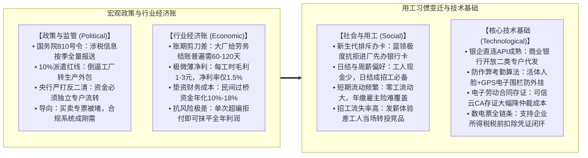
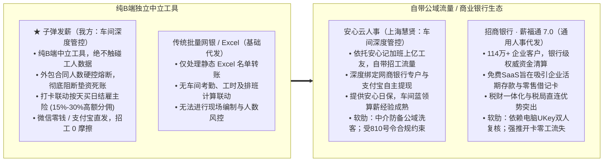
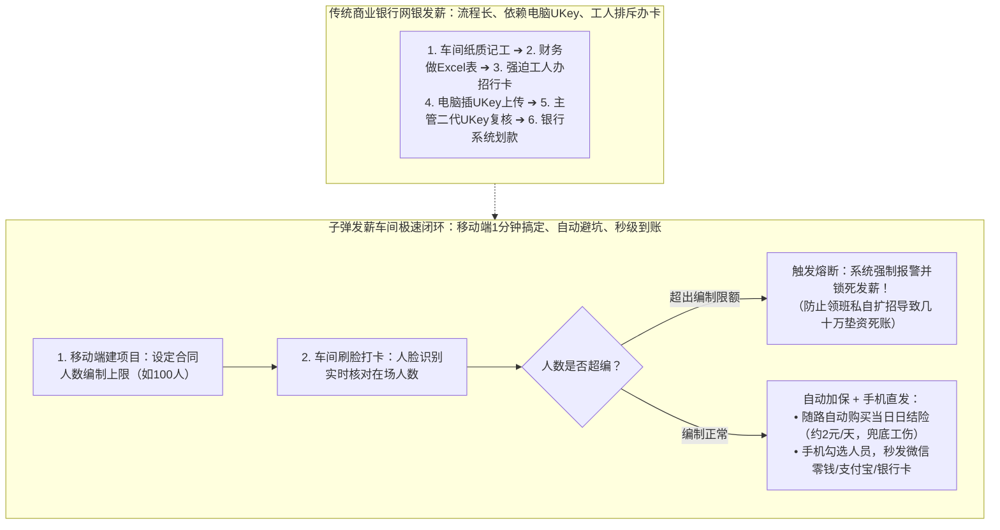
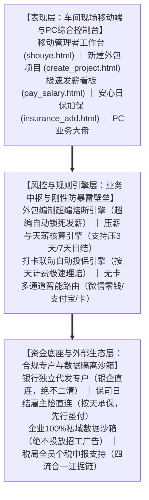
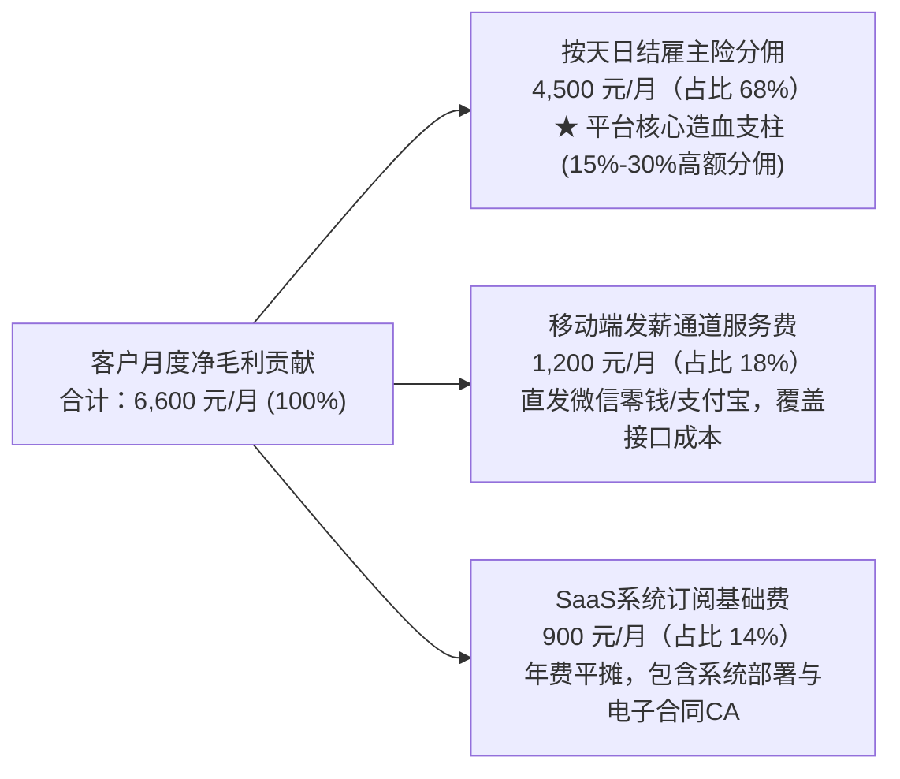

# 飞书专用·可编辑 Mermaid（美人鱼）代码合集（已修复版）

> **修复说明**：
> 1. 移除了数字区间里的波浪号 `-`（统一改为 `-`），彻底解决 Markdown 将两个 `-` 之间的文字误判为**删除线**的问题；
> 2. 移除了 Mermaid 中单独成行的 `---`，解决左侧多出一个空白 `[---]` 节点框的问题；
> 3. 采用 `graph LR` 配合双子图结构，在飞书中自动排列为规整的 **2×2 四宫格**。

---

### 图 1：外部宏观环境四大驱动力（PEST 框架）

---

### 图 2：三大竞品市场定位四象限矩阵

---

### 图 3：发薪流程实操对比（传统银行 vs 子弹发薪）

---

### 图 4：子弹发薪三层系统架构图

---

### 图 5：单客月均毛利构成（Unit Economics 财务账本）

